### Задание 1
Ключевые слова из синтаксиса:
 1.C++ - int, return, if, while, bool.

Я написала программу, в которой ключевые слова 'return' и 'while', используются в качестве имен переменых. При компиляции кода компилятор выдал ошибки.
Это подтверждает, что в С++ ключевые слова зарезервированы для синтаксиса языка, и их нельзя использовать в качестве имен переменных.
 
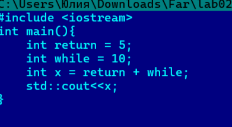
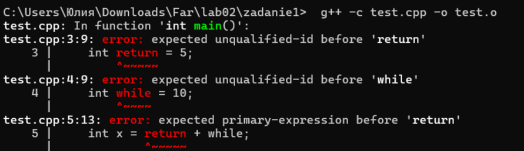

2.Java - public, static, void, new, class.

Написала программу для сложения двух чисел, где попыталась использовать ключевые слова class и new в качестве имен переменных.
Java не просто запрещает использовать ключевые слова как переменные — компилятор путается и выдает целый список ошибок подряд,
потому что пытается понять эти слова как команды языка, а не как имена. Программа не компилируется.

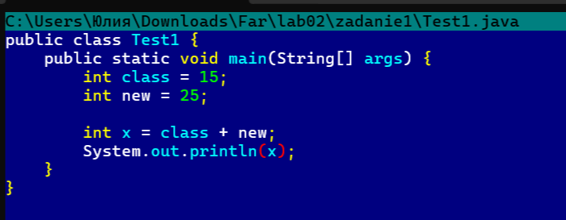
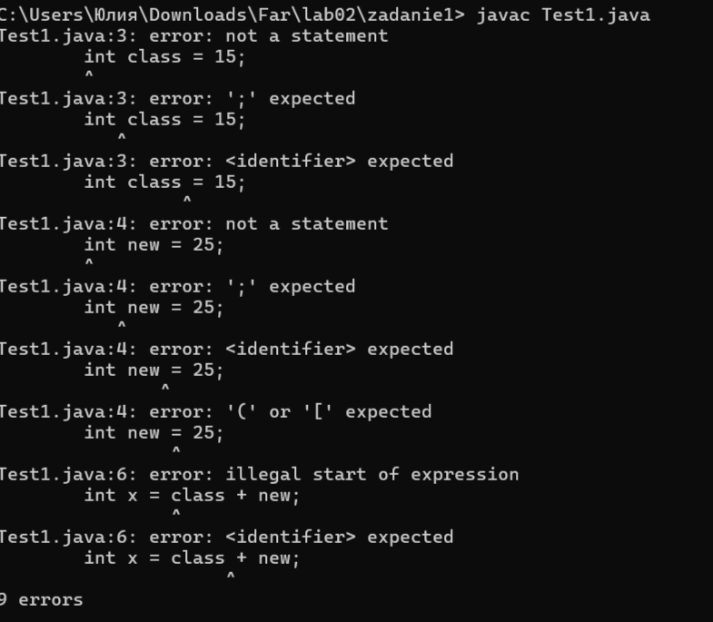

3.Python - def, return, if, else, import.

Для проверки я написала код, который складывает два числа, но имена переменных задала через if и else.
Интерпретатор выдал ошибку SyntaxError: invalid syntax сразу при чтении файла, указав на строку с if = num1 + num2.
Python не позволяет использовать ключевые слова как имена переменных. Ошибка появляется еще до запуска программы, потому что
интерпретатор проверяет синтаксис на этапе чтения файла.

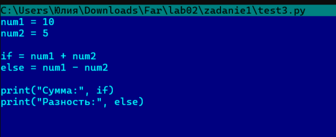
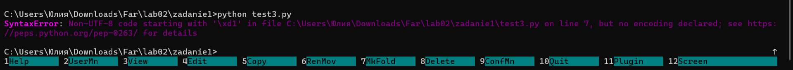

### Задание 2
 1. Программа на C++.
 
Разбиение на токены: int a = 1 , b = 2 ; int c = a ++ b] ;

При компилировании выдает ошибку:

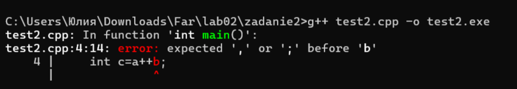

Причина ошибки: в C++ есть оператор ++ (инкремент). Лексер читает a++b и разбивает это на токены a, ++, b.
Компилятор понимает a++ как законченную операцию (увеличить a на 1 и вернуть старое значение). После этого он ожидает точку с запятой или математический
знак, но видит переменную b. Возникает синтаксическая ошибка.

 2. Программа на Python.
Разбиение на токены: a = 1 \n b = 2 \n c = a + + b

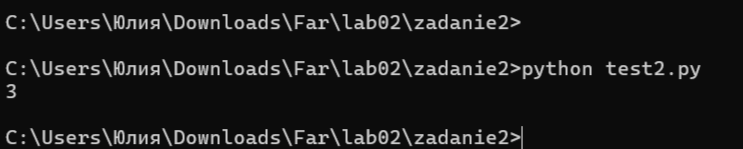

Здесь нет ошибки, потому что в Python нет оператора ++. Поэтому лексер не может собрать токен ++. Он разбивает a++b на отдельные токены: a, +, +, b. Python интерпретирует это как
a + (+b), то есть простое сложение a и b (унарный плюс перед b ничего не меняет). Это синтаксически корректное выражение, программа выполняется и выводит 3.

### Задание 3

1. Исходный код 

Разбиение на токены: int a = 1 , b = 2 ; int c = a ++ + b ;

Значения переменных после выполнения:

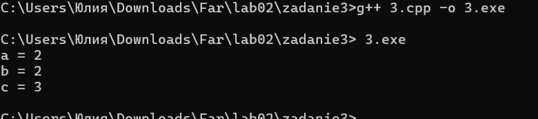

В C++ действует правило «максимального сопоставления». Согласно стандарту C (раздел 6.4 «Lexical elements»), лексер всегда выбирает самую
длинную последовательность символов, которая может образовать допустимый токен.
Компилятор читает a+++b слева направо. Он видит a, затем ++ (самый длинный допустимый оператор) и только потом +. Выражение разбирается как (a++) + b.
Сначала вычисляется a++ (возвращает 1, a становится 2), затем к результату (1) прибавляется b (2). Получается 3.

2. Вариант с пробелами: a + ++b
Разбиение на токены: int a = 1 , b = 2 ; int c = a + ++ b ;

Значения переменных после выполнения

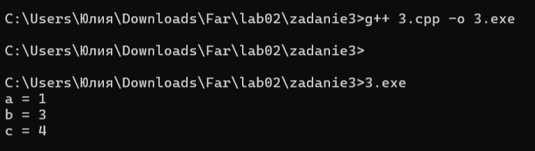

Пробел между первым и вторым плюсом разрывает последовательность +++. Теперь лексер видит отдельно + (бинарное сложение) и ++ (префиксный инкремент).
Сначала выполняется ++b — b увеличивается до 3. Затем a + 3 = 1 + 3 = 4.

3. Вариант с пробелами: a + + + b
Разбиение на токены: int a = 1 , b = 2 ; int c = a + + + b ;

Значения переменных после выполнения:

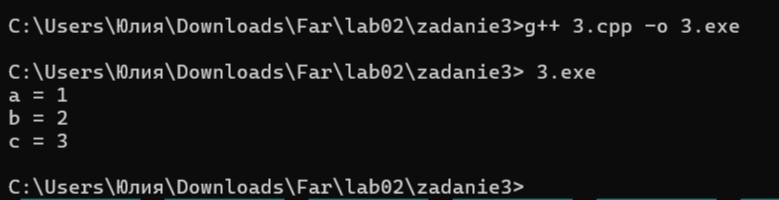

Здесь три отдельных оператора +. Первый — бинарное сложение, второй и третий — унарные плюсы (они не меняют значение). Выражение эквивалентно a + (+ (+b)).
Так как унарные плюсы ничего не делают, результат: 1 + 2 = 3.

4. Вариант с пробелами: a++ + b
Разбиение на токены: int a = 1 , b = 2 ; int c = a ++ + b ;

Значения переменных после выполнения:

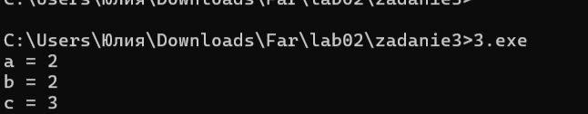

Пробел после ++ не меняет логику по сравнению с исходным кодом. Это тот же случай (a++) + b. a++ возвращает 1, a становится 2. Результат: 1 + 2 = 3.

### Задание 4
Круглые скобки ()

Скобки работают как операторы, когда с их помощью мы совершаем действие:
Вызов функции: func(a, b); — скобки заставляют функцию выполниться.

Приведение типа: (int)my_float; — скобки превращают число в другой тип.

Группировка: (a + b) * c; — скобки меняют порядок вычислений.

sizeof: sizeof(int); — скобки нужны для оператора размера.

Пример кода:

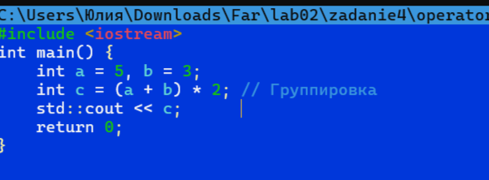

Не являются операторами:
Условие if: if (x > 0) — скобки просто отделяют условие от тела.

Цикл while: while (true) — то же самое.

Объявление функции: int main(), void func(int a) — скобки обозначают список параметров.

Пример кода:

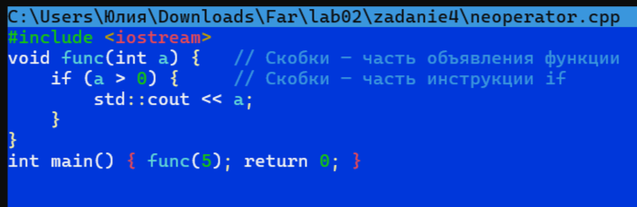

Квадратные скобки []

Являются операторорами:
Индексация: arr[i]; — скобки дают доступ к элементу массива.

Захват лямбды: [&](int x) { ... }; — скобки захватывают переменные.

new[] / delete[]: int* arr = new int[10]; — скобки выделяют память под массив.

Пример кода:

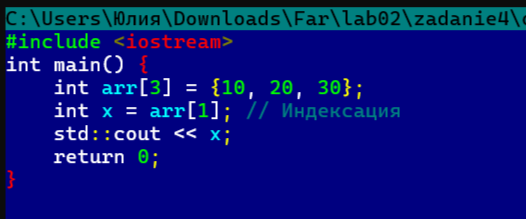

Не являются операторами:

Объявление массива: int arr[10]; — здесь скобки просто часть объявления переменной.

Пример кода:

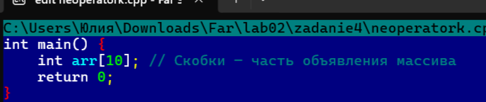

### Задание 5

 Разбор по категориям
Ключевые слова: for, in

Идентификаторы: print, map, sum, zip, int, input, i, split

Литералы: 1, 2, 3

Операторы: * (распаковка), , (разделитель), () (вызов), [] (список), . (доступ к методу)

 Переменные и функции
Переменная: i (счётчик цикла)

Имена функций/методов: print, map, sum, zip, int, input, split

Разбор по строчкам:

Строка input()
Параметров нет. Читает одну строку с клавиатуры. Пример: пользователь ввёл 1 2 — получаем строку "1 2".

Строка input().split()
Параметров нет. Разбивает строку по пробелам на части. Пример: "1 2" превращается в ["1", "2"].

Строка map(int, input().split())
Параметров два: функция int и список строк. Применяет int к каждой части. Пример: ["1", "2"] превращается в числа 1, 2.

Строка [map(int,input().split()) for i in (1,2,3)]
Параметров нет, это список. Выполняет предыдущий шаг 3 раза. Пример: если трижды ввести 1 2, 3 4, 5 6, получится три набора чисел: [1,2], [3,4], [5,6].

Строка *[...]
Параметров нет. Звёздочка «распаковывает» список. Три набора передаются дальше как три отдельных аргумента.

Строка zip(...)
Параметров: один (распакованный список). Объединяет числа по позициям. Пример: [1,2], [3,4], [5,6] превращаются в пары (1,3,5) и (2,4,6).

Строка map(sum, zip(...))
Параметров два: функция sum и результат zip. Суммирует числа в каждой паре. Пример: (1,3,5) даёт 9, (2,4,6) даёт 12.

Строка print(*map(...))
Параметров: один (распакованный результат map). Выводит числа через пробел. Пример: 9 12.

Что делает программа в итоге:
Просит ввести три строки с числами, складывает числа по столбикам и выводит результат.

Итог: что делает программа
Программа просит ввести три строки с числами, затем складывает числа по столбикам и выводит результат.

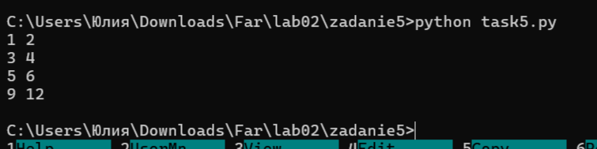

### Задание 6
Теория:
В C++ существует два способа записи комментариев:

1. Однострочные: начинаются с // и действуют до конца строки.
2. Многострочные: начинаются с /* и заканчиваются */.

Важно помнить: C++ не поддерживает вложенные комментарии. Как только компилятор встречает */, комментарий считается закрытым.

Разбор примеров
1. cout << "Hello /* Это комментарий */ world";

Верно. Комментарий находится внутри строки (в кавычках), поэтому компилятор считает его частью текста. Программа выведет: Hello /* Это комментарий */ world.

2. // /*
 Это комментарий
 */

Верно. Первая строка начинается с //, поэтому всё до конца строки игнорируется. Символы /* не открывают комментарий, так как уже внутри //.

3. /* Я комментирую программы /* комментарий */ */

Ошибка. C++ не поддерживает вложенные комментарии. Первый */ закрывает комментарий, а второй */ остаётся лишним — компилятор выдаёт ошибку.

4. // Я комментирую программы /* комментарий */

Верно. Строка начинается с //, поэтому всё до конца строки игнорируется, включая /* и */.

5. /* Я комментирую свои программы
 // Это комментарий до конца строки */ 
*/

Ошибка. Первый /* открывает комментарий, он закрывается на первом */. Последний */ на третьей строке — лишний, вызывает ошибку.

Вывод:
Синтаксически неверные примеры — 3 и 5. В обоих случаях ошибка из-за лишнего */, который не был «поглощён» комментарием. Это происходит потому, что C++ не поддерживает
вложенные комментарии: первый же */ закрывает блок.

### Задание 7
Как видно из правил, есть 4 инструкции циклов.
Первый вид — цикл while, который соответствует строке правила:
while ( condition ) statement

Формат записи (по правилу): ключевое слово «while» в круглых скобках условие «condition», далее инструкция «statement».

Пример программы.

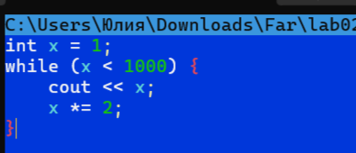

Второй вид — цикл do-while, который соответствует строке правила:
do statement while ( expression ) ;

Формат записи (по правилу): ключевое слово «do», далее инструкция «statement», ключевое слово «while» в круглых скобках выражение «expression», точка с запятой.

Пример программы.

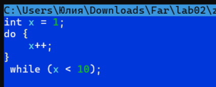

Третий вид — цикл for, который соответствует строке правила:
for ( init-statement condition_opt ; expression_opt ) statement

Формат записи (по правилу): ключевое слово «for» в круглых скобках инициализирующая инструкция «init-statement», необязательное условие «condition_opt», точка с запятой, необязательное выражение «expression_opt», далее инструкция «statement».

Пример программы.

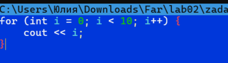

Четвертый вид — цикл for (по диапазону), который соответствует строке правила:
for ( for-range-declaration : for-range-initializer ) statement

Формат записи (по правилу): ключевое слово «for» в круглых скобках объявление переменной диапазона «for-range-declaration», двоеточие, инициализатор диапазона «for-range-initializer», далее инструкция «statement».

Пример программы.

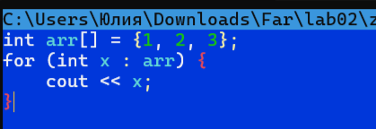

### Задание 8

a = -x + y * (z - 1);

Прежде чем строить дерево, определим порядок вычислений:

Скобки — выполняются первыми: (z - 1).

Умножение — следующий по приоритету: y * (z - 1).

Унарный минус — применяется к x: -x.

Сложение — выполняется последним: (-x) + (y * (z - 1)).

Присваивание — результат записывается в a.

2. Абстрактное синтаксическое дерево

          =
         / \
        a   +
           / \
          -   *
         /   / \
        x   y   -
               / \
ё              z   1