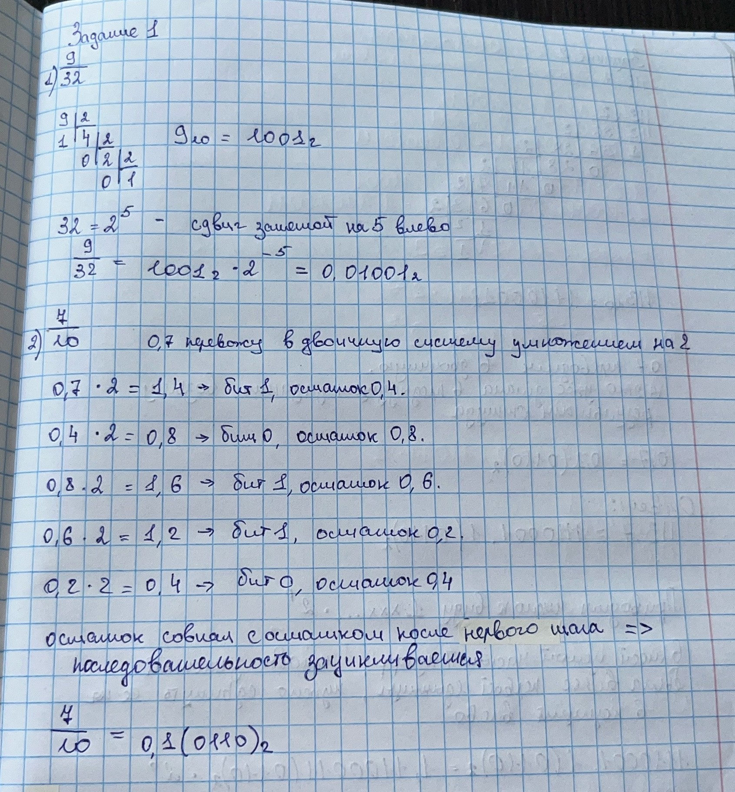
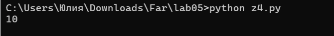
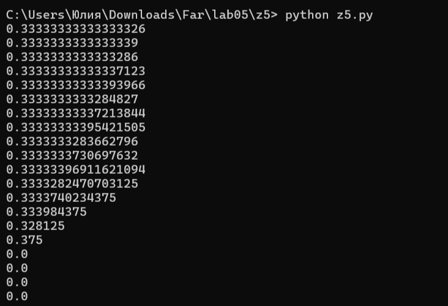

# Языки программирования
## Лабораторная работа 5

### Задание 1 **(2)**
*Переведите в двоичную запись два произвольных рациональных числа (числа вида* $\frac{p}{q}$).
*У одного из чисел знаменатель должен быть степенью двойки (32), а у другого --- некоторым числом
от 9 до 12.*

*Запись второго числа будет содержать период. Его надо найти. При решении задачи нельзя 
использовать вычислительную технику. Процесс решения должен быть представлен в отчете.*



### Задание 2 **(3)**
*Переведите в двоичную запись и найдите машинное представление в типе* **double**
*для произвольного вещественного числа большего, чем 100 с одним знаком после точки, например
для* $113.7$. *Цифра после точки не должна быть нулем иля пятеркой.*

*При решении задачи нельзя 
использовать вычислительную технику. Процесс решения должен быть представлен в отчете.*

.jpg)

.jpg)

### Задание 3 **(3)**
*Найдите сумму и произведение для записанных далее пар чисел. Числа заданы в двоичной записи 
в экспоненциальном виде. Ответ необходимо записать в нормализованннои экспоненциальном виде.*

* 1.0011e18 и $1.1001e21;
* 1.1011e-25 и, $1.1101e-23;
* 1.1011e-3 и $1.1011e1.

*При решении задачи нельзя использовать вычислительную технику. Процесс решения должен быть представлен в отчете.*

.jpg)

.jpg)

.jpg)

.jpg)


### Задание 4 **(2)**

*Рассмотрим следующий пример в IDLE Python*
```
>>> x = 99.99
>>> int(x/10+0.001)
9
```
*Результат должен был быть равен 10, однако оказался другим. Почему так произошло?
Как исправить программу, чтобы она корректно переводила вещественные числа в целые?*

Число 99.99 в двоичной системе точно не представляется, в памяти хранится 99.98999999999999488… После деления на 10 получается 9.998999999999999…,
после прибавления 0.001 — 9.999999999999998… То есть чуть меньше 10.

Функция int() отбрасывает дробную часть, а не округляет, поэтому от 9.999… остаётся 9.

Исправление — использовать округление:

int(round(x/10 + 0.001))

Тогда результат будет 10




### Задание 5. **(2)**

*Рассмотрите следующую программу. Объясните результаты ее работы. В частности,
как величина* $y$ *повлияла на ответ?*
```
x = 1/3
y = 1
for i in range(20):
    print((x+y)-y)
    y*=10
```
*В отчете требуется привести вычисления для оценки погрешности.*
Сначала в переменную x записывается 1/3, а в y — единица. Дальше идёт цикл, который повторяется 20 раз. На каждом шаге цикла:

1. Считается выражение (x + y) − y.

2. Результат выводится на экран.

3. Переменная y умножается на 10.

Когда компьютер складывает x и y, он выравнивает их порядки. Мантисса меньшего числа сдвигается вправо, и её младшие разряды теряются. Чем больше y, тем больше разрядов x теряется.

.jpg)

.jpg)

Таким образом, величина y напрямую влияет на точность результата. Чем больше y, тем больше погрешность, и в какой-то момент меньшее число теряется полностью. Это называется потерей значимости.




### Задание 6 **(2)**

*Для какого минимального значения* $n$ *программа на С++ выведет* **inf**? *Объясните
ответ.* *Что произойдет, если тип* **double** *заменить на* **long double**?
```
int n=...;
double s = pow(2, n);
std::cout << std::fixed << s << std::endl;
```

В double максимум порядка 1023, максимальное число ≈ 2^1024. Число 2^1024 переполняется и даёт inf. Значит, минимальное n = 1024.

Для long double (80 бит, порядок 15 бит) переполнение при n = 16384.

### Задание 7 **(2)**

*Допишите что-либо вместо многоточия программе на С++, чтобы программа при запуске выдавала ответ* **yes**.

```
double s = ...;
if (s != s)
  std::cout << "yes";
```

Условие s != s истинно только для специального значения NaN (Not a Number). Для обычных чисел оно всегда ложно — число равно самому себе.

Значит, вместо многоточия нужно присвоить s значение NaN:

```
#include <iostream>

int main() {
    double s = 0.0 / 0.0;
    if (s != s)
        std::cout << "yes";
    return 0;
}
```

### Задание 8 **(2)**

*Какое минимальное натуральное число при преобразовании в тип* **double** *записывается с погрешностью? Объясните
ответ. Почему следующее за ним число уже выводится без погрешности?*

В типе double под мантиссу отведено 52 бита. Плюс есть неявная единица — итого 53 значащих бита. Это значит, что все целые числа до 2^53 представляются точно.

2^53 = 9007199254740992.

После этого значения шаг между представимыми числами становится равен 2. То есть представляются только чётные числа: 9007199254740992, 9007199254740994, 9007199254740996 и так далее.

Число 9007199254740993 — нечётное. Оно попадает ровно между двумя представимыми числами, и компьютер округляет его до ближайшего. Поэтому оно записывается с погрешностью.

Следующее число 9007199254740994 — чётное. Оно точно попадает в узел сетки, поэтому записывается без погрешности.


###  Задание 9 **(2)**
*Напишите программу для решения следующей задачи.*

*Даны четыре рациональных числа. (Рациональное число - это число вида*
$\frac{p}{q}$, *где* $p$ *и* $q$ - *целые числа.) Напишите программу, которая сравнит сумму
двух первых чисел с суммой двух последних чисел. Программа должна выводить* $1$, $0$ *или* $-1$
*в зависимости от результатов сравнения. Решение можно проверить в проверяющей системе*
[http://olymp3.isu.ru/cgi-bin/new-client?contest_id=102](http://olymp3.isu.ru/cgi-bin/new-client?contest_id=102), *задача 03*.

```
t = int(input())
answers = []

for _ in range(t):
    p1, q1, p2, q2, p3, q3, p4, q4 = map(int, input().split())
    
    S1 = p1 * q2 * q3 * q4 + p2 * q1 * q3 * q4
    S2 = p3 * q1 * q2 * q4 + p4 * q1 * q2 * q3
    
    if S1 > S2:
        answers.append("1")
    elif S1 < S2:
        answers.append("-1")
    else:
        answers.append("0")

print(" ".join(answers))
```

## Дополнительные задания

### Задание 1 **(3)**

*Чем отличаются машинные представления чисел* $1$, $4096$, $0.0625$, *в типе* **double**? *Почему?*

### Задание 2 **(4)**
*Напишите программу для решения следующей задачи.*

*Даны четыре вещественных числа
a,b,c,d, не превосходящие 100 по модулю, записанные не более чем с 10 знаками после точки.
Требуется сравнить суммы a+b и c+d и определить, какая из них больше. Возможен случай,
что суммы будут равны.* 

*От вас требуется обосновать выбор значения* **eps** *при сравнении.*

### Задание 3 **(5)**
*Задано вещественное число в десятичной записи. Напишите программу для нахождения первых 1000 разрядов
этого числа в двоичной записи.*


### Задание 4 **(3)**
*Изучая чужой код, программист обнаружил такую функцию.*
```
long double acos_e(long double x, long double ep){
  if (x > 1+ep || x < -1-ep)
    return 0.0 / 0.0;
  else if (x>1)
    x=1;
  else if (x<-1)
    x=-1;
  return acos(x);
}
```
*Чем отличается эта функция от обычной функции арккосинуса? В чем смысл дополнительных проверок?*
### Задание 5 **(5)**
*Заданы координаты точек* $A$, $B$, $C$ *на плоскости. Координаты являются вещественными числами в диапазоне* $[0;10)$
*и содержат не более 6 знаков после точки. Используя формулу векторного произведения, напишите программу
для определения расположения* $C$ *относительно вектора* $AB$ *(слева, справа, на прямой).*

*От вас требуется обосновать выбор значения* **eps** при сравнении.*
