# Языки программирования
## Лабораторная работа 7

### Задание 1 **(2)**
*Оцените работу следующих фрагментов программ. Какие из них обладают неоднозначным поведением? Почему?*

```
int x=10, y=3;
std::cout << std::min(x=15, x+y);
```

В одном выражении переменная x изменяется (x=15) и читается (x+y). Порядок вычисления аргументов функции std::min стандартом не определён.

При разных порядках вычисления результат отличается:

Справа налево: сначала x+y = 13, затем x=15. Результат: min(15, 13) = 13.

Слева направо: сначала x=15, затем x+y = 18. Результат: min(15, 18) = 15.

Ответ: неоднозначное поведение.

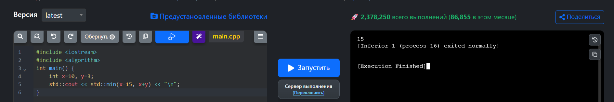

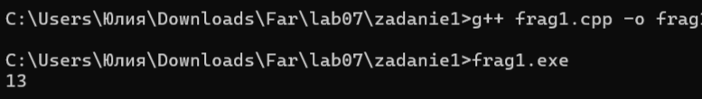


```
int x=10, y=3;
x=15, y+=x, x+=y;
```

В выражении используется оператор «запятая», который гарантирует вычисление слева направо. Левый операнд полностью завершается (включая присваивание) до начала правого.

Сначала x=15.

Затем y+=x: y = 3 + 15 = 18.

Затем x+=y: x = 15 + 18 = 33.

Результат: x=33, y=18. Неоднозначности нет.

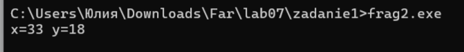

```
int x=10, y=9;
if (x>y++ && y++>9)
  cout << "yes" << endl;
cout << y;
```

Оператор && вычисляется слева направо. Если левый операнд ложен, правый не вычисляется. Здесь левый операнд истинен, поэтому вычисляется и правый.

Сначала x>y++: 10>9 — истина, y увеличивается до 10.

Затем y++>9: 10>9 — истина, y увеличивается до 11.

Условие истинно, выводится yes.

После условия выводится y, то есть 11.

Результат: yes, затем 11. Неоднозначности нет.

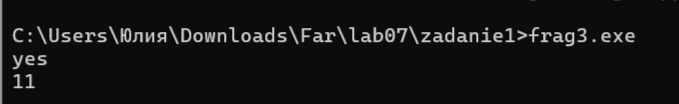

### Задание 2 **(2)**
*Как записать следующие строки программы на С++ в виде одного
выражения? Приведите несколько способов, в том числе с использованием операторов инкремента.*
*Проверьте работу написанных программ*
```
x=x+1;
z=z+2*x+3*y;
y=y+1;
```
*Тексты программ разместите в папке с номером задания*

Вариант 1 (оператор «запятая»):

```
x = x + 1, z = z + 2*x + 3*y, y = y + 1;
```

Оператор «запятая» гарантирует порядок вычисления слева направо. x увеличивается первым, затем это новое значение используется в z, и только потом увеличивается y.

Вариант 2 (префиксный инкремент):

```
z = z + 2*(++x) + 3*y, ++y;
```

++x сначала увеличивает x, а затем возвращает новое значение, которое сразу идет в z. Переменная y в z берется старой. ++y выполняется последним.

Вариант 3 (составное присваивание):

```
z = z + 2*(x += 1) + 3*y, y += 1;
```
Выражение (x += 1) увеличивает x и возвращает его новое значение.

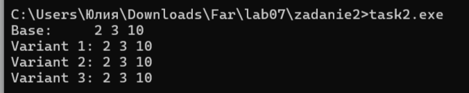

### Задание 3 **(2)**
*Рассмотрите следующий фрагмент программы. Он заполняет вектор из 10 элементов единицами.*
```
std::vector<int> x(10);
for (int i = 0; i < 10;)
   x[i++] = 1;
```
Выражение x[i++] использует постфиксный инкремент. Это значит, что сначала в качестве индекса берется текущее значение i, а уже после этого i увеличивается на 1.
Цикл выполняется, пока i < 10. Заполняются элементы от x[0] до x[9] единицами. После завершения цикла i равно 10.

*Перепишите ее так, чтобы в третьей строке использовался префиксный инкремент, но результат ее работы не изменился.*
```
std::vector<int> x(10);
for (int i = -1; i < 9;)
    x[++i] = 1;
```

Переменная i начинается с -1. В условии цикла теперь i < 9. На каждой итерации первым делом выполняется префиксный инкремент ++i. Он сразу увеличивает i на 1 и возвращает уже новое значение, которое используется как индекс.

1-я итерация: i = -1, условие -1 < 9 истинно. ++i делает i = 0, выполняется x[0] = 1.

2-я итерация: i = 0, условие 0 < 9 истинно. ++i делает i = 1, выполняется x[1] = 1.

...

10-я итерация: i = 8, условие 8 < 9 истинно. ++i делает i = 9, выполняется x[9] = 1.

Проверка после 10-й итерации: i = 9, условие 9 < 9 ложно, цикл завершается.

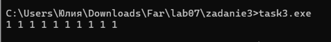

### Задание 4 **(2)**

*Почему присваивание* ```(++x)=y``` *является синтаксически правильным, а*
```(x++)=y``` - *нет? Запишите текст сообщения об ошибке, переведите и объясните его.*
Потому что ++x (префиксный инкремент) возвращает lvalue — ссылку на саму переменную x, у которой есть адрес в памяти. В нее можно записать новое значение. Поэтому (++x) = y работает. x++ (постфиксный инкремент) возвращает rvalue — временное значение (копию старого числа), у которого нет адреса в памяти. Присваивать что-то временному числу нельзя.

Поэтому компилятор выдает ошибку:

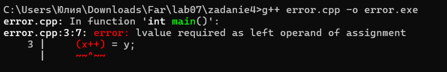

Перевод: «требуется lvalue в качестве левого операнда присваивания».

Объяснениe: компилятор сообщает, что слева от знака = должно находиться выражение, которое имеет адрес в памяти (lvalue). Выражение x++ возвращает временную копию значения, у которой нет адреса, поэтому она не может быть левым операндом присваивания.

### Задание 5 **(2)**

*Программисты на Python для обмена значений двух переменных часто пишут строку*
```
a,b = b,a
```
*Проверьте, будет ли аналогичная строка на С++ (с точкой с запятой в конце) являться синтаксически
правильной? Будет ли она обменивать значения переменных? Как в языке С++ вычисляется это выражение?*

Строка синтаксически правильна, компилируется без ошибок. Однако значения переменных она не обменивает.

Как она вычисляется:

Оператор «запятая» (,) имеет самый низкий приоритет. Поэтому выражение разбирается не как одновременное присваивание (как в Python), а как три отдельные части, выполняемые слева направо:

a — просто читается и сразу отбрасывается (никак не используется).

b = b — самоприсваивание, ничего не меняет.

a — снова читается и отбрасывается.

В результате никаких изменений в памяти не происходит, переменные остаются с прежними значениями.
 
Для сравнения я взяла стандартную функцию std::swap(a, b), которая выполняет правильный обмен значениями. В выводе ниже видно, что после запятой значения не поменялись, а после std::swap — поменялись.

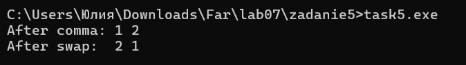

### Задание 6 **(2)**

*Проверьте работу следующего фрагмента программы*
```
  std::string s;
  for (int i=0; i<1000000; i++)
     s += 'a';
  std::cout << s.size();
```
*Измените третью строку на*
```
s=s+'a';
```
*Изменится ли что-нибудь в ее работе? Объясните результат.*

Вывод программы не изменится — в обоих случаях будет выведено 1000000. Однако время работы изменится.

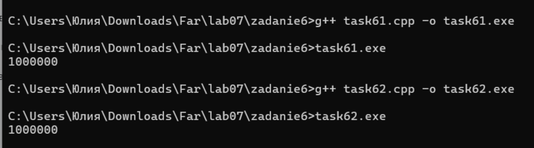

Я запустила оба варианта с циклом на 1 000 000 итераций. Вариант с s += 'a' выполнился мгновенно, а вариант с s = s + 'a' достаточно долго выполнялся.

(s += 'a'): Символ добавляется в конец уже существующей строки. Компьютер заранее выделяет память с запасом. Когда место заканчивается (а это происходит редко), строка переезжает в новый блок памяти большего размера. Благодаря этому копирование происходит редко, и программа работает быстро.

(s = s + 'a'): На каждой итерации создается абсолютно новая строка: компьютер копирует всю текущую строку целиком и добавляет в конец один символ. На 1-м шаге копируется 1 символ, на 2-м — 2, на 3-м — 3, и так до миллиона. В сумме количество скопированных символов получается огромным, и программа работает в сотни раз дольше.

Поэтому при миллионе итераций второй вариант работает на порядки дольше, хотя результат выводит одинаковый.


### Задание 7 **(2)**

*Как работает следующая программа? Как зависит результат от исходного значения?*
```
int x;
std::cin >> x;
x-->0 && x-->0 && x-->0 && x-->0 && x-->0;
std::cout << x;
```
В этой записи нет отдельного оператора -->. Символы -- — это постфиксный декремент, а > — операция сравнения. То есть выражение x-->0 читается компилятором как (x--) > 0.

Оператор && (логическое И) вычисляет свои операнды строго слева направо и останавливается, как только встречает ложь.

При вычислении каждого (x--) > 0:

Сначала текущее значение x сравнивается с нулём.

Затем, независимо от результата сравнения, срабатывает постфиксный декремент, и x уменьшается на 1. (Так как декремент постфиксный, он обязан выполниться, даже если сравнение дало ложь).

В цепочке записано ровно пять сравнений. Пусть пользователь ввёл число n.

Как зависит результат от исходного значения:

Если n <= 0: Первое же сравнение n > 0 даёт ложь. Оператор && останавливает работу. Но первый декремент уже сработал. Итог: x = n - 1.

Если 1 <= n <= 5: Проверки идут до тех пор, пока значение не станет нулём. На этом шаге сравнение даёт ложь, цепочка обрывается. Декремент в этом последнем сравнении срабатывает. Итог всегда один: x = -1.

Если n >= 5: Все пять сравнений (значения n, n-1, n-2, n-3, n-4 больше нуля) оказываются истинными. Срабатывают все пять декрементов. Итог: x = n - 5.

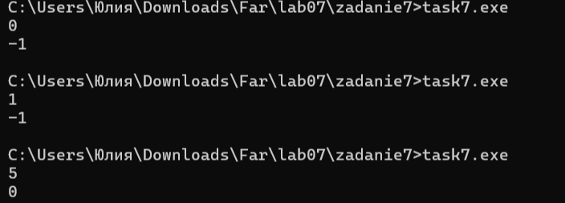

### Задание 8 **(3)**

*Какое число выводит следующий фрагмент программы? Посчитайте результат без использования
вычислительной техники. Отчет должен содержать процесс вычислений.*
```
int s = 0;
for (int i = 0, j = 5;i+j <= 16;(i<j ? i : j)++)
   (s += i) += j;
std::cout << s;
```
Тело цикла: (s += i) += j. Операция s += i прибавляет к s значение i и возвращает ссылку на s. Затем += j прибавляет к этому же s значение j. Итог: на каждой итерации к переменной s прибавляется сумма i + j.

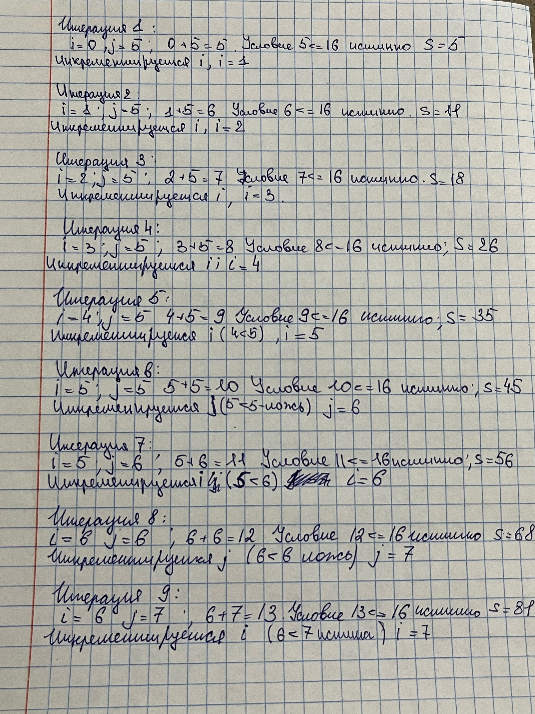

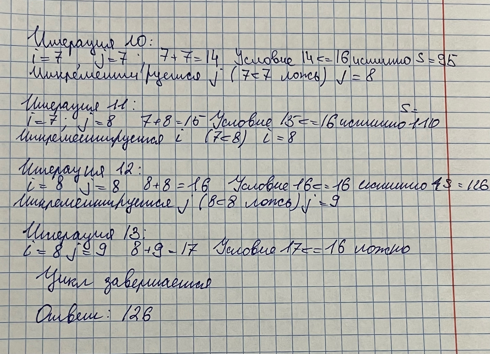


###  Задание 9 **(3)**
*Рассмотрите следующую программу. Предполагается, что на вход подается некоторый
индекс в массиве - число от нуля до девяти и значение, которое надо записать по этому индексу.*
```
int i = 0;
std::vector<int> x(10);
std::cin >> i >> x[i];
std::cout << x[i];
```
*Проверьте работу этой программы на различных компиляторах. Найдите два компилятора (можно 
проверить онлайн компиляторы), на которых эта программа будет давать различные ответы при одинаковом
вводе. Как это объяснить?*

## Дополнительные задания

### Задание 1 **(2)**

*Найдите и объясните примеры "коварных" ошибок программистов на С++, связанных с вычислением выражений. 
Каждый пример оценивается в два балла. Примеры из лекции или из заданий не засчитываются.*

### Задание 2 **(10)**
*Язык С++ позволяет записывать достаточно странные конструкции.
Следующая программа обладает неопределенным поведением. После компиляции с использованием 
Gnu C++ (g++) эта программа выводит числа 4 и 11. Рассмотрите ассемблерный код и объясните,
каким образом был получен ответ 11.*
```
int x, y;
y = (x=1) + (x=2) + (x=3) + (x=4);
std::cout << x << " " << y;
```

### Задание 3 **(10)**
*Прочитайте в стандарте языка С++ правила вычисления результата для тернарного оператора* **?:**. *Напишите примеры для каждого пункта правил.*

