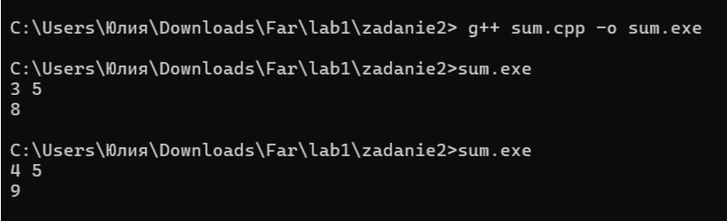
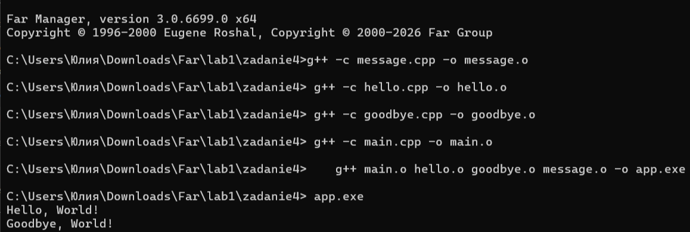
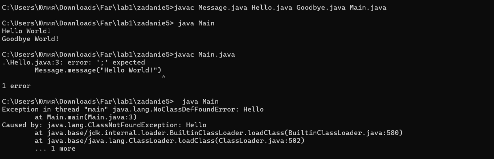
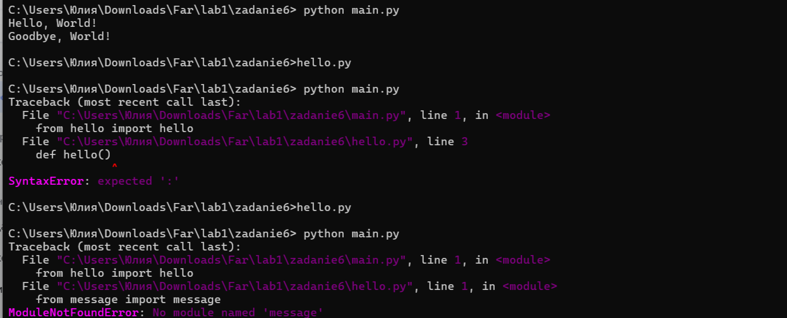
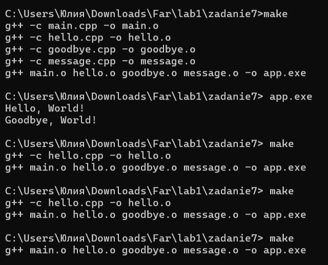

###Задание 1. Глоссарий
 1. Языки низкого уровня - это языки на которых можно
непосредственно написать программу, исполняемую на физическом
устройстве.
 2. Исполняемый файл (исполняемый код) — файл, содержащий
программу в виде набора элементарных инструкций, которая после
загрузки в память может быть выполнена на определенном
физическом устройстве (процессоре) под управлением опредленной
операционной системы.
 3. Ассемблер — язык программирования низкого уровня, в котором
каждая инструкция физического устройства представлена в текстовом
виде.
 4. Язык высокого уровня — язык программирования, абстрагирующийся
от элементарных команд процессора и позволяющий записывать программы в
виде более абстрактных понятий (функции, алгоритмы, классы, структуры
данных и т.д.); записывается в текстовом виде, ориентирован на удобство 
чтения человеком. Для выполнения требует транслятора.
 5. Исходный код - программа написанная на языке высокого уровня.
 6. Транслятор - специальная программа, которая нужна для выполнения программ, 
написанных на языке высокого уровня.
 7. Виртуальная машина — средство описания семантики языка программирования; 
описывает работу синтаксических конструкций, правила использования и поведение
при нарушении этих правил. Виды: физическое устройство под управлением ОС (языки
низкого уровня), программная реализация (Java), абстрактное описание (большинство языков).
 8. Стандарт языка программирования — документ, описывающий язык программирования максимально
подробно и, по возможности, наиболее формально; соглашение разработчиков языка и пользователей
о том, какие тексты следует считать программами и как эти программы будут исполняться. Развивающиеся
языки могут иметь несколько стандартов; новый стандарт не отменяет предыдущий, но может объявлять
её некоторые возможности устаревшими (deprecated).
 9. Транслятор — техническое средство, осуществляющее перевод
текста программы с одного языка на другой.
Изначально выделялись следующие виды трансляторов.
 10. Компилятор. Транслятор, переводящий программу в машинный код
для последующего исполнения (С++).
 11. Интерпретатор. Транслятор, читающий и исполняющий программу по
одной команде (Lisp).
 12. Псевдокомпилятор — транслятор, переводящий программу в
промежуточное представление (байт-код), который состоит из набора
инструкций близких по смыслу к машинному коду.
 13. Байт-код впоследствии выполняется на виртуальной машине.
Программа для исполнения байт-кода уже является интерпретатором.
Компилирующий интрепретатор — транслятор, переводящий
текст программы во внутреннем представление непосредственно после
запуска. В процессе работы программа интерпретируется уже в этом
представление (Python).
 14. Компилирующий интрепретатор может не сохранять внутреннее
представление кода в виде отдельного файла. В этом случае формат
внутреннего представления может зависеть от реализации.
 15. REPL-интерпретатор. Программное средство, работающее в
цикле чтения-вычисления-печати (Read-Eval-Print Loop).
Интерпретатор в режиме диалога считывает законченную конструкцию
языка, транслирует ее, исполняет и выводит результат (IDLE shell
Python).
 16. Единица трансляции — минимальный фрагмент программы,
который может быть транслирован независимо от остального кода.
 17. Ошибки синтаксические — ошибки, обнаруживаемые на этапе проверки синтаксиса во время трансляции.
 18. Ошибки сборки — ошибки, возникающие при отсутствии одного из компонентов программы.
 19. Ошибки с поздним обнаружением — ошибки, возникающие при выполнении программы.
 20. Ошибки времени выполнения (run time error) — ошибки использования
виртуальной машины языка программирования, обнаруживаемые в
момент их возникновения, например, деление на ноль или выход за
границы массива.
 21. Непредсказуемое поведение — в результате неверного использования
виртуальной машины языка программирования дальнейшее исполнение
программы может приводить к непредсказуемым ошибкам. То есть
ошибки проявляются позже в непредсказуемый момент в
непредсказуемом виде.
 22. Неопределенное поведение — поведение программы однозначно, но не
определено описанием языка. Программы с неопредленным поведением
могут давать различные результаты при использовании различных
трансляторов.
 23. Предобработка (препроцессинг) — начальный этап трансляции программы,
в ходе которого выполняются макроподстановки в исходный текст; результат — текст,
который далее проходит синтаксический анализ. Минус: текст, подаваемый на вход транслятору,
явно не записан, что может приводить к неожиданным ошибкам. В большинстве современных языков этот этап отсутствует.
 24. Директива #include — директива препроцессора C++; формально заменяется на содержимое указанного файла, фактически
используется для раздельной компиляции и подключения библиотек.
 25. Директива #define — директива препроцессора C++, позволяющая заменить имя макроса на его текст.
 26. Директива #pragma — директива препроцессора C++, используемая для задания параметров трансляции;
наборы параметров могут различаться в разных трансляторах.
 27. Условная трансляция — механизм препроцессора C++ (#ifdef, #ifndef, #else, #endif), 
позволяющий включать или исключать фрагменты кода в зависимости от условий.
Сборка — заключительный этап трансляции, результатом которого является исполняемый файл;
объединение отдельных модулей (единиц трансляции) и внешних библиотек.
 28. Объектный файл — результат трансляции модуля; переходный этап от текста программы к исполняемому
файлу. Содержит имена идентификаторов из текста программы, но команды уже переведены на язык исполнителя.
 29. make — утилита для управления процессом компиляции и сборки программ; собирает и хранит информацию о
зависимостях в единицах трансляции и использует её для оптимизации процесса трансляции; запускает процесс сборки,
записанный в файле makefile (без расширения).

###Задание 2. Справка по горячим клавшиам Far Manager.
Смена панели - Tab
Вход в папку - Enter
Выход из папки вверх - Ctrl + PgUp
Создание папки - F7
Создание файла - Shift + F4
Редактирование файла - F4
Просмотр файла - F3
Копирование - F5
Переименование / перемещение - F6
Удаление - F8
Сохранение в редакторе - F2
Закрытие редактора - F10
Командная строка вход/выход - Cntrl + O

### Задание 3.

### Задание 4.

.png)
Проверка 1. Я убрала в файле hello.cpp точку с запятой затем ввела команду g++ -c main.cpp -o main.o она выполнилась успешно — каждая единица трансляции компилируется независимо.
Проверка 2. Я удалила файл hello.o провела сборку и она выдала ошибку cannot find hello.o: No such file or directory. После восстановления hello.o сборка прошла успешно.
### Задание 5.

Проверка 1. Я убрала точку с запятой в Hello.java и попробовала скомпилировать Main.java, компилятор сразу выдал ошибку. Java, в отличие от C++, при компиляции одного файла автоматически
проверяет и связанные с ним классы.
Проверка 2. Я удалила файл Hello.class и попробовала запустить программу командой java Main. Программа не запустилась — появилась ошибка NoClassDefFoundError, потому что класс Hello не был найден.
### Задание 6.

Проверка 1. Я убрала двоеточие в hello.py и попробовала запустить main.py. Программа не запустилась — появилась ошибка SyntaxError.
Проверка 2. Я удалила файл message.py и снова запустила main.py. Появилась ошибка ModuleNotFoundError: No module named 'message' — Python не нашёл нужный модуль для импорта.
### Задание 7.

Make — утилита для управления процессом компиляции и сборки программ. Она собирает и хранит информацию о зависимостях в единицах трансляции и использует её для оптимизации процесса трансляции.
Выделение сборки в отдельный этап увеличивает скорость трансляции, поскольку, как правило, изменения вносятся только в одну единицу трансляции.
### Задание 8.
.png)
.png)

.png)
.png)

.png)
.png)

.png)
.png)

.png)
.png)

.png)
.png)

