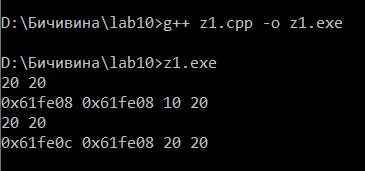
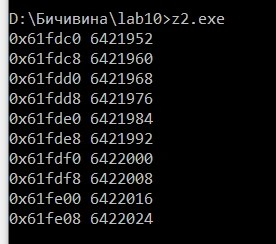
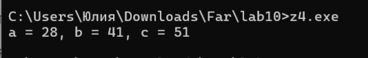
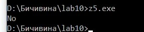
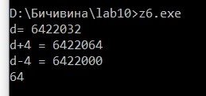
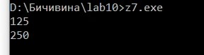
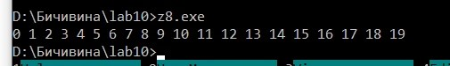
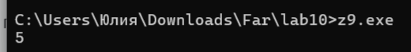

# Языки программирования
## Лабораторная работа 10

### Задание 1 **(2)**

*Рассмотрите следующие фрагменты программ. Запишите, что означают символы* **&** и  * *в каждом случае применения.*
```
int a = 10, b = 20;
int *p = &a , *q = &b;
p = q;
std::cout << *p <<' '<< *q << std::endl;
```
```
int a = 10, b = 20;
int *p = &a , *q = &b;
*p = *q;
std::cout << *p <<' '<< *q << std::endl;
```
*Чем различаются присваивания в третьей строке? Что можно вывести,
чтобы показать различия?*

*Примеры программ сохраните в папке с номером задания. Скриншоты работы прикрепите к отчету.*

Символ * в объявлении переменной это описатель указателя.

Символ * в выражении означает оператор разименования.

Символ & означает оператор взятия адреса.

В первой программе адрес котрый был в q присваивается р. р а указывают на одну переменную b.

Во втором случае они указывают на разные переменные и мы просто их скопировали.

```#include <iostream>
using namespace std;

int main() {
    int a = 10, b = 20;
    int *p = &a, *q = &b;
    p = q;
    
    cout << *p << " " << *q << endl;
    cout << p << " " << q << " " << a << " " << b << endl;


    int d= 10, c=20; 
    int *s= &d, *r= &c;
    s= *r
 
    cout << *s<< " " << *r<< endl;
    cout << s<< ""<< r<< " " << d<< " " << c<< endl;

    return 0;
}
```




### Задание 2 **(1)**

*Рассмотрим следующую программу.* 
```
double x[10];
for (int i = 0; i <10; i++)
    std::cout << &x[i] << std::endl;
```
*Что она выводит? Измените
вывод так, чтобы адреса выводились в десятичной системе счисления.
Объясните почему числа составляют арифметическую прогрессию с
определенным шагом.*

*Записанную программу сохраните в папке с номером задания.*
*Скриншоты работы прикрепите к отчету.*

```#include <iostream>
int main(){
	double x[10];
	for (int i = 0; i <10; i++)
   	 std::cout << &x[i] <<' '<< reinterpret_cast<size_t>(&x[i])<< std::endl;
   return 0;
}
```



Программа выводит адреса всех 10 элементов массива double x[10]. Слева — в шестнадцатеричном виде, справа — тот же адрес, приведённый к size_t через reinterpret_cast, то есть в десятичной системе. Приведение нужно именно для того, чтобы увидеть адрес как обычное число.

Адреса образуют арифметическую прогрессию, потому что элементы массива лежат в памяти непрерывно, друг за другом. Тип double занимает 8 байт — значит каждый следующий элемент дальше предыдущего ровно на 8 байт. Шаг прогрессии = sizeof(double) = 8.

### Задание 3 **(2)**

*Токен* **«*»** *в языке C++ может использоваться в трех различных
случаях. Аналогично токен* **«&»** *также может использоваться в трех
случаях. Приведите пример одной программы в которой они были бы
использованы во всех случаях.*

*Записанную программу сохраните в папке с номером задания.*

Код:

```
#include <iostream>

// & как ссылка в параметре функции
void inc(int &r) { r++; }

int main() {
    int a = 10, b = 3;

    // * — описатель указателя
    int *p = &a;          // & — взятие адреса

    // * — разыменование
    std::cout << "*p = " << *p << "\n";

    // * — умножение
    std::cout << "a * b = " << a * b << "\n";

    // & — побитовое И
    std::cout << "a & b = " << (a & b) << "\n";

    // & — ссылка
    int &ref = a;
    inc(ref);
    std::cout << "a after inc = " << a << "\n";

    return 0;
}
```


### Задание 4 **(2)**

*Выпишите значения всех переменных, в том числе указателей,
после выполнения каждой инструкции программы. Объясните, что
происходит в результате выполнения каждой инструкции.*
```
unsigned a = 8, b = 3 ,c = 17;
unsigned *p = &a;
unsigned *q = &b;
*p += *q + c;
c = *q;
p = &c;
c += a;
*p += 10;
*q = *p;
q = p ;
*q += 10;
```

Разбор по строкам:

1. unsigned a=8, b=3, c=17; — начальные значения: a=8, b=3, c=17, указатели ещё не заданы.

2. unsigned *p=&a; — p получает адрес a. Теперь *p — это a (значение 8).

3. unsigned *q=&b; — q получает адрес b. Теперь *q — это b (значение 3).

4. *p += *q + c; — разыменовываем: *p = *p + (*q + c) = 8 + (3 + 17) = 28. Значение a становится 28. Итог: a=28, b=3, c=17.

5. c = *q; — c = b = 3. Итог: a=28, b=3, c=3.

6. p = &c; — p теперь указывает не на a, а на c. Важно: a больше не меняется через p. Итог: a=28, b=3, c=3, p→c, q→b.

7. c += a; — c = c + a = 3 + 28 = 31. Итог: a=28, b=3, c=31.

8. *p += 10; — *p — это уже c (так как p→c), поэтому c = 31 + 10 = 41. Итог: a=28, b=3, c=41.

9. *q = *p; — *q — это b, *p — это c, значит b = 41. Итог: a=28, b=41, c=41.

10. q = p; — q теперь указывает туда же, куда и p, то есть на c. Итог: a=28, b=41, c=41, p→c, q→c.

11. *q += 10; — *q — это c, поэтому c = 41 + 10 = 51. Итог: a=28, b=41, c=51.

Итоговые значения: a = 28, b = 41, c = 51; оба указателя p и q указывают на c.

На шаге 6 указатель p переключили с a на c, поэтому a перестает изменяться и остается равным 28, а все дальнейшие операции через *p меняют c. На шаге 10 q тоже переключили на c — теперь p и q смотрят в одно место, и шаг 11 увеличивает именно c.





### Задание 5 **(1)**

*Что сравнивается в приведенной ниже программе? Как можно
изменить первую строчку программы, чтобы результат тоже
изменился?*
```
int x = 1, y = 2;
int *p = &y, *q = &x;
if (p < q)
    std::cout << "Yes";
else
    std::cout << "No";
```



Сравниваются адреса &y и &x, а не числа 2 и 1. Результат зависит от того, в каком порядке компилятор разместил локальные переменные в стеке — этот порядок стандартом не гарантирован и может отличаться между компиляторами и даже между запусками.

Как изменить первую строку, чтобы результат поменялся: поменять местами объявление переменных, чтобы изменился порядок их размещения в памяти:

### Задание 6 **(2)**

*Объясните работу следующей программы. Как изменится
результат, если тип* **double** *изменить на некоторый другой, например*
**int** *или* **char**?

```
double x = 0;
double *d = &x;
std::cout << reinterpret_cast<size_t>(d + 4) - reinterpret_cast<size_t>(d - 4) << std::endl;
```

Код:

```#include <iostream>
int main(){
    {
    double x = 0;
    double *d = &x;
    std::cout << "d= " << reinterpret_cast<size_t>(d) << std::endl;
    std::cout << "d+4 = " << reinterpret_cast<size_t>(d+4) << std::endl;
    std::cout << "d-4 = " << reinterpret_cast<size_t>(d-4) << std::endl;
    std::cout << reinterpret_cast<size_t>(d + 4) - reinterpret_cast<size_t>(d - 4) << std::endl;
  }
return 0;
```




1. double x = 0; — объявляется переменная x типа double со значением 0. Тип double занимает 8 байт.

2. double *d = &x; — указатель d получает адрес x. Теперь d смотрит на x.

3. d + 4 — арифметика указателей: смещение на 4 элемента вперёд. Так как элемент — double (8 байт), смещение в байтах = 4 * 8 = 32 байта.

4. d - 4 — смещение на 4 элемента назад, то есть на -4 * 8 = -32 байта от d.

5. reinterpret_cast<size_t>(...) — каждый из полученных адресов приводится к целому числу size_t, чтобы можно было вычесть их как обычные числа (в байтах).

6. Разность: (адрес d + 32) − (адрес d − 32) = 64. Программа выводит 64.

Получаем 64 потому что между d + 4 и d − 4 ровно 8 элементов типа double, а каждый элемент — 8 байт. Итого 8 * 8 = 64 байта. Обратите внимание: если бы мы вычли сами указатели (d + 4) - (d - 4), результат был бы 8 — потому что разность указателей выражается в элементах, а не в байтах. Здесь же адреса приведены к size_t, поэтому вычитаются байты.

Как изменится результат при смене типа:

int (4 байта): 8 * 4 = 32

char (1 байт): 8 * 1 = 8

float (4 байта): 8 * 4 = 32


### Задание 7 **(2)**

*Объясните работу следующей программы. Как изменится
результат, если тип* **double** *изменить на некоторый другой, например*
**int** *или* **char**?

```
std::cout << reinterpret_cast <double*>(3000) - reinterpret_cast <double*>(2000) << std::endl;

```
Код:

```#include <iostream>
int main(){
{
	std::cout << reinterpret_cast <double*>(3000) - reinterpret_cast <double*>(2000) << std::endl;
}
{
	std::cout << reinterpret_cast <int*>(3000) - reinterpret_cast <int*>(2000) << std::endl;
}
return 0;
}
```




Числа 3000 и 2000 приводятся к указателям заданного типа через reinterpret_cast. Затем вычисляется разность двух указателей одного типа. В C++ такая разность даёт не количество байт, а количество элементов этого типа, умещающихся между адресами: (3000 − 2000) / sizeof(T). Для double (8 байт) получаем 1000 / 8 = 125, для int (4 байта) — 1000 / 4 = 250.

Как изменится результат при смене типа: результат равен 1000 / sizeof(T). Для char было бы 1000, для double — 125. Чем больше размер типа, тем меньше значение разности, потому что шаг арифметики указателя равен размеру типа. Сами адреса 3000 и 2000 условны — разыменовывать такие указатели нельзя, это неопределённое поведение.


### Задание 8 **(2)**

*Что надо дописать в записанной ниже программе вместо многоточий, чтобы
она выводила все числа из массива* **a**? *Почему?*

```
int a[20];
for ( int i = 0; i < 20; i++)
    a[i] = i;
int *b=a + 8;
for (int i =...; i <...; i++)
    std::cout << b[i] <<' ';
```



Указатель b указывает на a[8], то есть b == a + 8. Выражение b[i] равносильно *(b + i), а значит a[8 + i]. Чтобы напечатать весь массив от a[0] до a[19], нужно, чтобы 8 + i пробегало от 0 до 19. Отсюда i меняется от −8 до 11 включительно, то есть условие продолжения — i < 12. Отрицательный индекс здесь допустим: b[-8] — это *(b − 8), что после смещения на −8 от b попадает ровно в a[0], то есть внутрь массива, поэтому обращение корректно и не приводит к неопределённому поведению.


### Задание 9 **(2)**

*Что выводит следующая программа? Изменится ли результат если
изменить тип элементов массива?*

```
int a[10];
std::cout << &a[8] - &a[3] << std::endl;
```

Берутся адреса двух элементов одного массива — &a[8] и &a[3] — и вычисляется их разность. В C++ разность указателей на элементы одного массива даёт количество элементов между ними, а не количество байт. Поэтому результат равен 8 − 3 = 5. Программа выведет 5.

Изменится ли результат при смене типа элементов: нет. Разность указателей на элементы массива всегда выражается в элементах и равна разности индексов, независимо от типа. Если бы адреса были приведены к size_t и вычитались как числа, тогда результат зависел бы от размера типа: для double это было бы 5 * 8 = 40, для char — 5 * 1 = 5 байт. Но в данном коде вычитаются именно указатели, поэтому тип не влияет — всегда 5.



### Задание 10 **(1)**

*Есть ли разница между инициализацией* **p** и **q** *в следующей программе? Обоснуйте ответ.*

```
int x [10]={1, 2, 3, 4, 5, 6, 7, 8, 9, 10};
int *p = x + 5;
int *q = &x[5];
```

Есть ли разница: нет, разницы нет. Оба указателя инициализируются одним и тем же адресом — адресом элемента x[5], и после инициализации они полностью эквивалентны.

Имя массива x в выражении автоматически преобразуется (decay) в указатель на его первый элемент, то есть x эквивалентно &x[0]. Тогда x + 5 — это адрес пятого элемента, что в точности совпадает с &x[5]. Поэтому p == q, и оба указывают на x[5] (значение 6).

### Задание 11 **(3)**

*Указатели можно использовать для итерации по массивам.
Напишите программу, которая найдет сумму элементов массива,
используя указатели. В начале цикла указатель требуется установить
на начало массива, в конце каждой итерации смещать его к
следующему элементу массива через инкремент. Для выхода из цикла
надо проверять, что указатель дошел до конца массива.*
```
int x [10]={1, 2, 3, 4, 5, 6, 7, 8, 9, 10};
int s = 0;
for (int *p = ...; ...; ...)
    s += ...
std::cout << s;
```


В начале цикла указатель p устанавливается на начало массива — x (это то же самое, что &x[0]). На каждой итерации *p даёт значение текущего элемента, и оно прибавляется к сумме s. После каждой итерации p инкрементируется (++p), то есть смещается к следующему элементу. Условие продолжения — p != x + 10: как только указатель доходит до адреса «за последним элементом», цикл завершается. В итоге суммируются все 10 элементов, программа выводит 55.


## Дополнительные задания

### Задание 1 **(3)**

*Запишите программу на С++, в которой будет создаваться двумерный массив* **x[10][10]**. *Выведите адреса элементов массива и нарисуйте, как элементы расположены в памяти.*

### Задание 2 **(3)**

*Запишите программу на С++, в которой будет создаваться двумерный массив* **x[10][10]**. *Проверьте, что произойдет при различных выходах за границы массива. Напишите программы для демонстрации и поясните
их работу.* 

### Задание 3 **(6)**
*Напишите пример программы, которая продемонстрирует неопределенное поведение при выходе за границу одномерного массива. Например, чтобы программа зависла, хотя по алгоритму такого не должно произойти

### Задание 4 **(8)**
*Изучите самостоятельно работу с динамической памятью. Напишите примеры программ, демонстрирующие особенности работы (например, перемещение при расширении) и возможные ошибки при работе с памятью.* 

