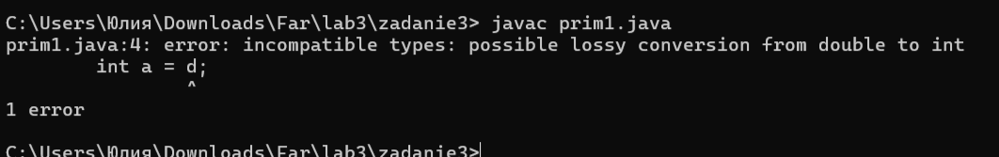
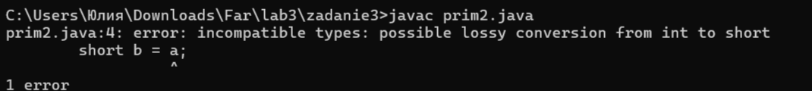
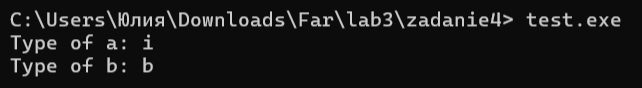
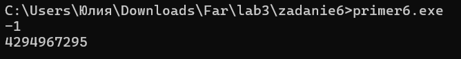
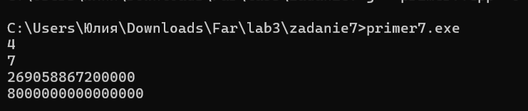
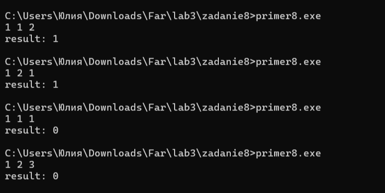
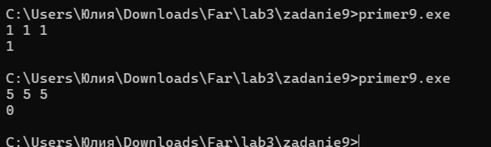
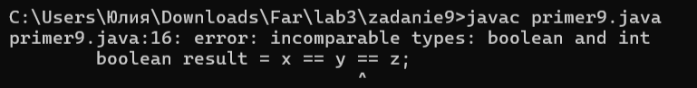

# Языки программирования
## Лабораторная работа 3

### Задание 1 **(3)**
*Составьте глоссарий из определений лекции. Проверка отчета будет включать 
проверку знания определений*
* **Тип в программировании** - атрибут объекта данных, задающий множество допустимых значений и методы для работы с ними. 
* **Статическая типизация** - типизация, при которой тип объекта данных определяется в момент трансляции (компиляции).
Литералы — по записи, переменные и константы — по объявлению, результаты выражений — по оператору и типу операндов.
* **Динамическая типизация** — типизация, при которой тип объекта данных определяется на этапе выполнения программы в момент создания или присваивания значения.
* **Неявная типизация** - тип определяется на этапе трансляции автоматически по тексту программы
* **Явное преобразование типа** - преобразование типа, указанное в программе в виде вызова функции или в виде операции.
* **Неявное преобразование типа** - преобразование типа, которое не присутствует в программе в виде конкретного указания, однако транслятор сам подставляет требуемый метод преобразования.
* **Сильная типизация** — язык программирования не содержит (почти не содержит) правил неявного преобразования типа.
* **Слабая типизация** — язык программирования содержит большое число правил неявного преобразования типа, допускает каламбуры типизации.

### Задание 2 **(3)**
*Запишите правила неявного преобразования типов в языке С++*

*Проверка отчета будет включать проверку знания правил.*

*Преобразования при присваивании*
При присваивании значение правого операнда приводится к типу левого операнда.

При инициализации значение инициализатора приводится к типу инициализируемой переменной.

При вызове функции фактический параметр приводится к типу формального параметра.

При возврате из функции возвращаемое значение приводится к типу возврата функции.

*Преобразования при арифметических действиях*
Если длины обоих типов меньше int, то оба типа преобразуются к int.

Если типы разной длины, то меньший тип преобразуется к большему.

Если типы равной длины и один знаковый, а другой беззнаковый, то знаковый тип приводится к беззнаковому.

Если один тип целый, а другой вещественный, то целый тип приводится к вещественному.

Если оператор требует целого числа, то операнд приводится к целому типу. К таким операторам относятся:
суффиксный инкремент, суффиксный декремент, сдвиги, остаток от деления, битовые операции.

При преобразовании из вещественного типа в целочисленный дробная часть отсекается.

При преобразовании с символьными типами значение определяется по коду символа.

*Преобразования с логическими значениями*
Результат условного выражения в инструкциях ветвления и цикла приводится к логическому типу.

Если оператор требует логического значения, то операнды приводятся к логическому типу. К таким операторам относятся логические операции.

При преобразовании в bool: значение 0 даёт false; все остальные значения дают true.

При преобразовании из bool: false даёт 0; true даёт 1.

### Задание 3 **(2)**

*Языки C++ и Java имеют похожий синтаксис, однако
язык С++ относят к языкам со слабой статической типизацией, а Java - с сильной статической типизацией.
Приведите примеры, показывающие это различие. Для этого вам надо подобрать несколько близких по смыслу фрагментов программ,
которые будут транслироваться в С++, но вызывать ошибку согласования типов в Java.*

*Записанные программы сохраните в папке с номером задания. В отчет запишите пояснения к работе программ.*

Пример 1. Присваивание дробного числа целой переменной
Код на C++:

```
#include <iostream>

int main() {
    double d = 9.99;
    int a = d;
    std::cout << "a = " << a << std::endl;
    return 0;
}
```

В C++ можно спокойно присвоить double переменной типа int. Компилятор неявно преобразует число, просто отбрасывая дробную часть.
Программа скомпилируется и выведет a = 9.

Java:
```
public class prim1 {
    public static void main(String[] args) {
        double d = 9.99;
        int a = d;  
        System.out.println("a = " + a);
    }
}
```



В Java так сделать нельзя. Компилятор выдаст ошибку, Java требует явно указать, что мы согласны потерять точность: int a = (int) d;. Без этого программа не соберется.

Пример 2.  Присваивание int переменной типа short

C++:

```
#include <iostream>

int main() {
    int a = 1000;
    short b = a;
    std::cout << "b = " << b << std::endl;
    return 0;
}
```

C++ позволяет присвоить int переменной short. Если число влезает в диапазон short, все нормально. Если не влезает — будет переполнение, но программа все равно скомпилируется. Здесь выведется b = 1000.

Java:

```
public class prim2 {
    public static void main(String[] args) {
        int a = 1000;
        short b = a;  
        System.out.println("b = " + b);
    }
}
```

Java не позволяет присвоить int переменной short без явного приведения. Компилятор выдаст ошибку Придется писать short b = (short) a;.

### Задание 4 **(1)**

*Рассмотрите следующий фрагмент программы.*

```
bool x = true, y = false;
auto a = x & y;
std::cout << typeid(a).name() << std::endl;
auto b = x && y;
std::cout << typeid(b).name() << std::endl;
```
*Используя* **typeid**, *найдите типы переменных* **a** и **b**. *Объясните результат.*

*Записанную программу сохраните в папке с номером задания.*


Здесь у нас два похожих выражения, но компилятор понимает их по-разному, и из-за этого типы переменных получаются разными.

В первом случае переменная a вычисляется через x & y. Это побитовое «И». Особенность в том, что этот оператор не работает с логическим типом bool напрямую.
Поэтому компилятор сначала автоматически превращает true и false в обычные числа 1 и 0 (тип int). Операция выполняется над числами, и результат тоже
получается целым числом. Именно поэтому typeid для переменной a выводит i, то есть int.

Во втором случае переменная b вычисляется через x && y. Это уже логическое «И». Оно специально сделано для логики и не превращает bool в числа.
Оно просто сравнивает два логических значения и выдает результат тоже в виде логического типа. Поэтому здесь тип остается bool, и typeid выводит букву b.




### Задание 5. **(2)**

*Приведите разумные (логичные) примеры использования в 
С++ ключевых слов* **typedef, auto, decltype, static_cast** и оператора **sizeof**.

*Записанные программы сохраните в папке с номером задания. В отчет запишите пояснения к программам*.

1.typedef

```
#include <iostream>

typedef double Price;

int main() {
    Price bread = 45.50;
    Price milk = 89.90;

    std::cout << "Bread: " << bread << std::endl;
    std::cout << "Milk: " << milk << std::endl;
    return 0;
}
```
Здесь typedef используется, чтобы дать типу double более понятное имя — Price. Технически Price — это тот же double, но когда читаешь код и видишь Price bread, сразу понятно, что переменная хранит цену,
а не просто какое-то дробное число. Если в программе много разных double (цены, веса, температуры), такие имена помогают не запутаться.

2.auto

```
 #include <iostream>
int main() {
    auto count = 10;       // int
    auto price = 99.99;    // double
    auto letter = 'A';     // char

    std::cout << count << std::endl;
    std::cout << price << std::endl;
    std::cout << letter << std::endl;
    return 0;
}
```
Ключевое слово auto позволяет не указывать тип вручную. Компилятор сам смотрит на значение справа и подставляет нужный тип. Здесь видно, что auto сам подобрал тип под значение: целое стало int,
дробное — double, символ — char. Удобно, когда тип длинный или неочевидный.

3.decltype

```
 #include <iostream>
int main() {
    int a = 10;
    double b = 3.5;

    // Тип result будет таким же, как у a + b, то есть double
    decltype(a + b) result = 13.5;

    // А здесь тип y будет int, потому что x — это int
    int x = 5;
    decltype(x) y = 100.5;   // дробная часть отбросится

    std::cout << "result = " << result << std::endl;  // 13.5
    std::cout << "y = " << y << std::endl;            // 100
    return 0;
}
```

В первом случае decltype(a + b) даёт тип double, потому что int при сложении с double превращается в double. Поэтому 13.5 сохраняется полностью. Во втором случае decltype(x) даёт тип
int, потому что x — это int. А раз переменная целая, дробная часть от 100.5 просто отбрасывается, и в y оказывается 100. Так наглядно видно, что decltype определяет тип по выражению, а не по значению, которое мы туда записываем.

4.static_cast

```
 #include <iostream>
int main() {
    double price = 199.99;

    // Явно превращаем double в int, дробная часть отбрасывается
    int intPrice = static_cast<int>(price);

    std::cout << "intPrice = " << intPrice << std::endl;
    return 0;
}
```
static_cast — это явное приведение типов. Здесь мы специально говорим компилятору: «преврати double в int». Дробная часть при этом просто отбрасывается, получается 199. Это удобно, когда нужно специально сменить тип.

5.sizeof
``` 
 #include <iostream>
int main() {
    int a = 0;
    double b = 0.0;

    std::cout << "sizeof(int) = " << sizeof(int) << " bytes" << std::endl;
    std::cout << "sizeof(a) = " << sizeof(a) << " bytes" << std::endl;
    std::cout << "sizeof(b) = " << sizeof(b) << " bytes" << std::endl;

    return 0;
}
```

sizeof возвращает размер типа или переменной в байтах. Можно применять и к типу (например, sizeof(int)), и к самой переменной. В примере видно, что int занимает 4 байта, переменная a (типа int) — тоже 4 байта, а переменная b (типа double) — 8 байт.


### Задание 6 **(2)**

Рассмотрите следующий фрагмент программы. 
```
int a = -1, b = 1;
unsigned int c = 1;
std::cout << a*b << std::endl;
std::cout << a*c << std::endl;
```
* *Объясните работу этой программы, используя правила неявного преобразования типов*
* *Что произойдет, если тип* **int** *заменить на* **short**, а **unsigned int** на **unsigned short**?*

В программе три переменные. a и b — это обычные целые числа со знаком (int), то есть могут быть и положительными, и отрицательными. c — это unsigned int, то есть беззнаковое целое, которое может быть только нулём или положительным.

Сначала считается a * b. Оба числа типа int, значит результат тоже int. -1 умножить на 1 будет -1. Так и выводится.

Потом считается a * c. Тут один операнд int, а второй unsigned int. По правилам C++ в такой ситуации знаковый операнд превращается в беззнаковый, потому что они одинакового размера. То есть наша -1 превращается в очень большое положительное число.
Если считать в 32-битной системе, это 4294967295. Умножаем на 1, получаем то же самое число. Поэтому вместо -1 выводится 4294967295.



Что будет, если заменить int на short, а unsigned int на unsigned short:

Если написать так:
```
short a = -1, b = 1;
unsigned short c = 1;
```
То результат изменится. Потому что в C++ типы меньше int (а short и unsigned short как раз меньше) перед арифметикой всё равно приводятся к int. То есть a станет int со значением -1, c станет int со значением 1. Операция пройдёт между двумя int, и результат будет -1.

.png)


### Задание 7 **(2)**
*Рассмотрите следующий фрагмент программы.*
```
int x = 7, y = 4;
long double d = 0.25;
cout << (x / y) / d << endl;
cout << (x / d) / y << endl;
long a = 200000, b = 200000;
long long c = 200000;
std::cout << (a * b) * c << std::endl;
std::cout << a * (b * c) << std::endl;
```
*Почему изменения порядка действий приводит
к изменению результата? Объясните работу этой программы, используя правила неявного преобразования типов*



Сначала про деление. В первой строке (x / y) / d сначала выполняется x / y. Оба операнда типа int, поэтому деление целочисленное: 7 / 4 даёт 1, остаток отбрасывается. Дальше результат делится на d. Так как d — long double, тип int неявно преобразуется в long double, и получается 1.0 / 0.25 = 4.0.
Во второй строке (x / d) / y порядок другой. Сначала x делится на d. Типы разные, поэтому int преобразуется в long double, и деление сразу идёт как дробное: 7.0 / 0.25 = 28.0. Потом результат делится на y, и снова int преобразуется в long double: 28.0 / 4.0 = 7.0.
Разница в том, что в первом случае неявное преобразование случилось только на втором шаге, когда целочисленное деление уже отбросило дробную часть. Во втором случае преобразование произошло сразу, и результат сохранился точно.

Теперь умножение. Переменные a и b имеют тип long, c — long long.
В строке (a * b) * c сначала считается a * b. Оба операнда типа long, поэтому результат тоже long. Но 200000 * 200000 = 40 000 000 000, а тип long на моей системе занимает 4 байта, и максимум, что туда влезает, — около 2 миллиардов. Происходит переполнение, и результат получается неправильным — 269058867200000. Дальше это число умножается на c, и c как long long преобразуется в long long, но это уже не спасает ситуацию, потому что исходное значение было испорчено.
Во второй строке a * (b * c) порядок другой. Сначала считается b * c. Здесь b — long, c — long long. По правилам неявного преобразования long превращается в long long, потому что этот тип шире. Умножение идёт уже в 64-битном типе, куда 40 миллиардов влезает без проблем. Потом a тоже преобразуется в long long, и итог получается правильным — 8 000 000 000 000 000.

### Задание 8 **(2)**

*Для каких значений целочисленных переменных* **x**, **y** ,**z** *результатом
вычисления следующего выражения будет истина? Перечислите* **все** *случаи.
Объясните работу этой программы, используя правила неявного преобразования типов*

```
(x == y) + (x == z) == true
```

*Записанные программы сохраните в папке с номером задания.*

Сначала смотрим на (x == y) + (x == z). Каждое сравнение даёт результат типа bool. Дальше эти два bool складываются оператором +. По правилу преобразований при арифметических действиях: если длины обоих типов меньше int, то оба типа преобразуются к int.
Bool меньше int, поэтому оба значения превращаются в int. По правилу преобразования из bool: false даёт 0, true даёт 1. Складываются уже целые числа, результат тоже int.

Получиться может 0, 1 или 2:

0 — если x не равен ни y, ни z.

1 — если x равен ровно одному из них.

2 — если x равен и y, и z одновременно.

Дальше этот int сравнивается с true. Тут работает правило преобразований с логическими значениями: если оператор требует логического значения, то операнды приводятся к логическому типу. Оператор == как раз требует логического значения. Поэтому int преобразуется в bool по правилу: 0 даёт false, все остальные значения дают true. А true — это уже логическое значение, с которым и идёт сравнение. По сути получается: «сумма равна true», то есть «сумма не равна нулю и равна именно true». Так как true — это 1, выражение истинно только тогда, когда сумма равна 1.

Разбираем случаи:

Первый случай: x равен y, но не равен z. Тогда первое сравнение даёт true (1), второе даёт false (0). Сумма 1. Выражение истинно.

Второй случай: x равен z, но не равен y. Тогда первое сравнение даёт false (0), второе даёт true (1). Сумма 1. Выражение истинно.

Если x равен и y, и z (все три равны), то оба сравнения дают true, сумма 2. Выражение ложно.

Если x не равен ни y, ни z, оба сравнения дают false, сумма 0. Выражение тоже ложно.



### Задание 9 **(2)**

*Проверьте работу логического выражения*
```
x==y==z
```
*в языках* **Python**, **Java**, **C++** *для
целочисленных переменных* **x**, **y**, **z**.
*Объясните результат для каждого из языков.*

**C++:

```
 #include <iostream>
int main() {
    int x, y, z;
    std::cin >> x >> y >> z;

    bool result = x == y == z;
    std::cout << result << std::endl;

    return 0;
}
```

В C++ оператор == левоассоциативный, поэтому выражение x == y == z читается как (x == y) == z.

Сначала вычисляется x == y. Результат этого сравнения имеет тип bool. Дальше этот bool сравнивается с z, а z — это int. Чтобы сравнение было возможно, компилятор применяет правило неявного преобразования: при преобразовании из bool false даёт 0, а true даёт 1.

То есть true превращается в 1, и сравнение идёт уже между двумя числами: 1 == z.

Например, если ввести x = 5, y = 5, z = 5:
Сначала (5 == 5) даёт true. Потом true превращается в 1. И 1 == 5 даёт false. Результат false, хотя все три числа равны.

Если ввести x = 1, y = 1, z = 1:
(1 == 1) даёт true, true превращается в 1, и 1 == 1 даёт true. Результат true.

То есть выражение истинно только тогда, когда первое сравнение дало true, а третье число равно 1. 



**Java:

```
import java.util.Scanner;

public class primer9 {
    public static void main(String[] args) {
        Scanner scanner = new Scanner(System.in);

        System.out.print("x:");
        int x = scanner.nextInt();

        System.out.print("y:");
        int y = scanner.nextInt();

        System.out.print("z:");
        int z = scanner.nextInt();

        boolean result = x == y == z;
        System.out.println(result);
    }
}
```
В Java оператор == тоже левоассоциативный, как и в C++. Но тут есть особенность: результат сравнения — это boolean, а boolean в Java нельзя сравнивать с числом int. В Java не работает правило неявного преобразования bool в int, которое есть в C++.

Поэтому компилятор выдаст ошибку ещё на этапе сборки программы. Такая запись в Java просто не скомпилируется.



**Python:

```
x = int(input("x: "))
y = int(input("y: "))
z = int(input("z: "))

result = x == y == z
print("Python:", result)
```

В Python выражение x == y == z — это цепочечное сравнение. Это специальная конструкция языка, которая проверяет, что все три числа равны между собой.

Здесь нет никаких неявных преобразований bool в int, как в C++. Python просто сравнивает числа напрямую.

Если ввести x = 5, y = 5, z = 5, результат будет True.
Если ввести x = 1, y = 1, z = 2, результат будет False.
То есть работает так, как ожидается в математике.


### Задание 10 **(1))**

*Напишите программу на* **Python** *, демонстрирующую возможность неявного преобразования
строки в логическое значение.*

*Записанную программу сохраните в папке с номером задания.*

```
s = input("Введите строку: ")

if s:
    print("Строка непустая - True")
else:
    print("Строка пустая - False")
```
Программа запрашивает у пользователя строку. Дальше эта строка подставляется в условие if s:. Python неявно преобразует её в логическое значение: если строка непустая — это True, если пустая — False. Мы нигде не пишем len(s) > 0 или s != "", преобразование происходит само.
