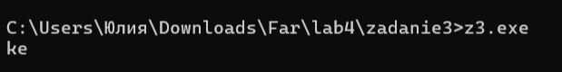
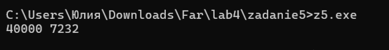
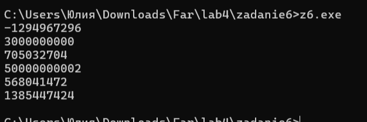

# Языки программирования
## Лабораторная работа 3

### Задание 1 **(3)**
* *Запишите двоичное представление числа -99 в целочисленном знаковом типе длиной 1, 2, 4 байта.* 
* *Запишите литералы равные наибольшему и наименьшему числу в типе* **int** *в шестнадцатеричной записи.*
* *Запишите двоичное представление символа "`#`" в типе* **char**.

1. представление числа -99 в целочисленном знаковом типе длиной 1, 2, 4 байта.

Чтобы перевести число в двоичную систему, нужно последовательно делить его на 2 и записывать остатки. Деление продолжается до тех пор, пока частное не станет равно нулю.

Затем остатки записываются в обратном порядке (снизу вверх).

Получилось 7 бит. Но тип char занимает 8 бит, поэтому дополняем слева нулём: 01100011.

В памяти отрицательные числа хранятся в дополнительном коде. Чтобы получить дополнительный код, нужно:

Взять двоичную запись модуля числа.

Инвертировать все биты (0 заменить на 1, а 1 на 0).

Прибавить к результату единицу.

Модуль числа: 01100011.

Инвертируем все биты: 10011100.

Прибавляем единицу: получили −99 в 8-битном представлении: 10011101

Для типов большей длины используется то же правило, но старшие биты заполняются знаковым битом. Так как число отрицательное, все лишние старшие биты равны 1.

Для 16 бит: к 8-битному представлению слева добавляем 8 единиц: 1111111110011101

Для 32 бит: добавляем 24 единицы: 11111111111111111111111110011101

2. Максимальное и минимальное значение типа int.

Тип int занимает 4 байта, то есть 32 бита.

В знаковом типе один бит (самый старший) отводится под знак. Остальные 31 бит — под само число.

Максимальное значение получается, когда все 31 бит равны 1, а знаковый бит равен 0 (число положительное):

0111 1111 1111 1111 1111 1111 1111 1111

Это число равно 2³¹ − 1 = 2147483647.

Переведём в шестнадцатеричную систему. Для этого разбиваем двоичную запись на группы по 4 бита:


0111 = 7

1111 = F

1111 = F

1111 = F

1111 = F

1111 = F

1111 = F

1111 = F

Получается 7FFFFFFF. С префиксом 0x: 0x7FFFFFFF.

Минимальное значение получается, когда знаковый бит равен 1, а все остальные биты равны 0:

1000 0000 0000 0000 0000 0000 0000 0000

Это число равно −2³¹ = −2147483648.

В шестнадцатеричной системе получается 80000000. С префиксом 0x: 0x80000000.

Ответ:

Максимальное значение: 0x7FFFFFFF

Минимальное значение: 0x80000000

1.3. Символ # в типе char

Каждому символу в таблице ASCII соответствует свой числовой код. По таблице ASCII символ # имеет код 35.

Переведём 35 в двоичную систему делением на 2, записываем остатки в обратном порядке: 100011. Дополняем слева нулями до 8 бит: 00100011.

Ответ: 00100011


### Задание 2 **(3)**
*Напишите пример программы на С++ с использованием целочисленных литералов в разных форматах записи, 
разной длины, знаковых и беззнаковых. 
Пример должен охватывать большинство способов записи целочисленных литералов.*
```
 #include <iostream>
int main() {
    int a = 23;
    int b = 027;
    int c = 0x17;
    int d = 0b10111;

    unsigned int e = 23u;
    long f = 23l;
    unsigned long g = 23ul;
    long long h = 23ll;
    unsigned long long i = 23ull;

    std::cout << "Different number systems:\n";
    std::cout << "decimal:      " << a << "\n";
    std::cout << "octal:        " << b << "\n";
    std::cout << "hexadecimal:  " << c << "\n";
    std::cout << "binary:       " << d << "\n";

    std::cout << "\nDifferent types:\n";
    std::cout << "unsigned int:       " << e << "\n";
    std::cout << "long:               " << f << "\n";
    std::cout << "unsigned long:      " << g << "\n";
    std::cout << "long long:          " << h << "\n";
    std::cout << "unsigned long long: " << i << "\n";
```


### Задание 3 **(2)**
*Объясните работу фрагмента программы на С++. В ходе объяснения следует использовать таблицу кодов символов.*

```
char a = 'a';
a = a + 10;
std::cout << a;
a = a + 250;
std::cout << a;
```

Тип char занимает 1 байт и может хранить числа от 0 до 255. Внутри переменной хранится код символа по таблице ASCII, а при выводе показывается сам символ.

Символ 'a' имеет код 97. После a = a + 10 получается 107. По таблице ASCII код 107 — это символ 'k'. Он выводится на экран.

Затем a = a + 250 даёт 357. Но в 1 байт помещается максимум 255. Когда число становится больше 255, счёт начинается заново с нуля, как будто коробка переполнилась. Число 357 на 256 больше, чем 101, поэтому в переменной оказывается 101. Код 101 — это символ 'e'. Он тоже выводится.

Ответ: программа выведет ke.



### Задание 4 **(2)**

*Перепишите программу из предыдущего задания на Python, используя функции* **chr** и **ord**.
*Почему ее вывод отличается от вывода программы на С++?*

```
a = ord('a')            
a = a + 10              
print(chr(a), end='')  
a = a + 250             
print(chr(a))           
```

В Python нет фиксированного размера для целых чисел. Число 357 остаётся числом 357, ничего не обрезается. Функция chr(357) возвращает символ Unicode с кодом 357 — это 't' (латинская t со знаком ударения).
Никакого переполнения не происходит.


### Задание 5. **(2)**

*Объясните работу фрагмента программы на С++. В частности, почему* $x+x-x=x$, *но при этом*
$(x\cdot 2)/2\neq x$? *В отчете надо привести вычисления, приводящие к ответу.*
```
unsigned short x = 40000;
unsigned short y = x + x;
unsigned short z = x * 2;
y = y - x;
z = z / 2;
std::cout << y << " " << z << std::endl;
```

В программе используется тип unsigned short — это 16-битное число, которое может принимать значения от 0 до 65535. Если результат вычисления превышает 65535, то из него вычитается 65536, и счёт начинается как бы заново.

Переменная x равна 40000. Когда мы считаем x + x, получается 80000. Это больше 65535, поэтому вычитаем 65536 и получаем 14464. То же самое происходит при x * 2 — результат тоже 14464.

Дальше мы делаем y - x, то есть 14464 - 40000. Получается отрицательное число, но unsigned short отрицательных не хранит. Поэтому мы идём по кругу: прибавляем 65536 и получаем 40000. А z / 2 — это просто 14464 разделить на 2, получается 7232.

Программа выведет: 40000 7232.

Разница между x + x - x и (x · 2)/2 вот в чём. В первом случае мы сначала потеряли 65536 при сложении, а потом вернули его обратно при вычитании — поэтому получили исходное x. Во втором случае мы тоже потеряли 65536 при умножении, но потом разделили

уже испорченное число на 2, и вернуть потерянное не получилось. Поэтому (x · 2)/2 не равно x.




### Задание 6 **(2)**

*Объясните работу фрагмента программы на С++. Если имеет место переполнение, 
то требуется найти точный ответ до запуска программы, а только потом сверить его с выводом.
В отчете надо привести вычисления, приводящие к ответу.*
```
std::cout << 2000000000 + 1000000000 << std::endl;
std::cout << 2000000000U + 1000000000U << std::endl;
std::cout << 2500000000U + 2500000000U << std::endl;
std::cout << 2500000000LL + 2500000000LL << std::endl;
std::cout << 20000U * 200000U << std::endl;
std::cout << 200000U * 200000U << std::endl;
```

Строка 1. 2000000000 + 1000000000

Оба литерала — обычные int (знаковые). Сумма: 3000000000.

Это больше максимума int (2147483647). Переполнение.

Вычитаем 2³²: 3000000000 − 4294967296 = −1294967296.

Ответ: −1294967296

Строка 2. 2000000000u + 1000000000u

Оба литерала помечены суффиксом u, значит тип unsigned int. Сумма: 3000000000.

Это меньше 4294967295, поэтому переполнения нет.

Ответ: 3000000000

Строка 3. 2500000000u + 2500000000u

Оба unsigned int. Сумма: 5000000000.

Это больше 4294967295. Переполнение.

Вычитаем 2³²: 5000000000 − 4294967296 = 705032704.

Ответ: 705032704

Строка 4. 25000000001L + 25000000001L

Оба литерала помечены суффиксом L, значит тип long (64 бита). Сумма: 50000000002.

Это число спокойно помещается в 64 бита. Переполнения нет.

Ответ: 50000000002

Строка 5. 200000 * 2000000u

Первый литерал — int, второй — unsigned int. При смешанной операции int приводится к unsigned int, поэтому оба становятся беззнаковыми.

Произведение: 200000 · 2000000 = 400000000000.

Это больше 4294967295. Переполнение.

Считаем остаток от деления на 2³²: 400000000000 mod 4294967296 = 568041472.

Ответ: 568041472

Строка 6. 2000000u * 2000000u

Оба unsigned int. Произведение: 4000000000000.

Это больше 4294967295. Переполнение.

Остаток от деления на 2³²: 4000000000000 mod 4294967296 = 1384298496.

Ответ: 1384298496




### Задание 7 **(2)**

*Напишите программу на Python умножающую введенное число на 1000. В программе 
можно использовать только операторы сдвига и сложения. Циклы использовать нельзя. Из функций
можно использовать только* **input** *и* **print** *для ввода и вывода.*

```
x = int(input())
y = (x << 9) + (x << 8) + (x << 7) + (x << 6) + (x << 5) + (x << 3)
print(y)
```

Сначала input() читает число, int() превращает его в целое. Затем мы складываем шесть сдвинутых копий числа x. Каждый сдвиг даёт x, умноженное на соответствующую степень двойки. В сумме получается x * 1000.
Функция print() выводит результат.


### Задание 8 **(2)**

*Найдите результаты вычисления следующих выражений без использования компьютера
или калькулятора. Процесс вычислений должен быть отображен в отчете.*
* `(1000 & 100) << 10`
* `(1000 >> 4) & 15`
* `~1234 + 1234`
* `(1000 ^ 500) & 63`
* `(100 << 3) + (100 >> 3)`

1. (1000 & 100) << 10

Переведём числа в двоичную систему.

1000 = 512 + 256 + 128 + 64 + 32 + 8 = 1111101000
100 = 64 + 32 + 4 = 0001100100

Побитовое И:

1000: 1111101000

100:  0001100100

&:    0001100000

Результат 0001100000 = 32 + 16 = 96.

Сдвиг влево на 10: 96 · 1024 = 98304.

Ответ: 98304

2. (1000 >> 4) & 15

Сначала сдвиг вправо: 1000 / 16 = 62 (остаток отбрасывается).

62 в двоичном: 111110

15 в двоичном: 001111

Побитовое И:

62: 111110

15: 001111

&:  001110

Результат 001110 = 8 + 4 + 2 = 14.

Ответ: 14

3. ~1234 + 1234

Правило: ~x = −x − 1.

Значит, ~1234 = −1235.

−1235 + 1234 = −1.

Ответ: −1

4. (1000 ^ 500) & 63

1000 = 1111101000

500 = 0111110100

Исключающее ИЛИ (1, если биты разные):

1000: 1111101000


500:  0111110100

^:    1000011100

Результат 1000011100 = 512 + 16 + 8 + 4 = 540.

Теперь 540 & 63:

540 = 1000011100

63 = 0000111111

540: 1000011100

63:  0000111111

&:   0000011100

Результат 0000011100 = 16 + 8 + 4 = 28.

Ответ: 28

5. (100 << 3) + (100 >> 3)

100 << 3 = 100 · 8 = 800

100 >> 3 = 100 / 8 = 12 (остаток отбрасывается)

800 + 12 = 812

Ответ: 812


###  Задание 9 **(2)**
*Напишите программу на языке С++ для умножения заданного целого числа на* $-1$. *В программе можно использовать только сложение и битовые
операции. Условия, циклы, библиотечные функции использовать нельзя.*

```
#include <iostream>

int main() {
    int x;
    std::cin >> x;
    int y = ~x + 1;
    std::cout << y << std::endl;
    return 0;
}
```
std::cin >> x — читаем число с клавиатуры.

~x — переворачиваем все биты.

+ 1 — прибавляем единицу.

std::cout << y — выводим результат.

## Дополнительные задания

### Задание 1 **(3)**

*Какие значения можно присвоить целочисленной переменной* **x**,
*чтобы результатом выражения `x|(x+1)` стало число 895?
Найдите все значения без использования компьютерных вычислений. 
Обоснуйте ответ.*

Переведём 895 в двоичную систему: 895 = 1101111111.

Свойство операции |: если число x оканчивается на k единиц, то x+1 оканчивается на k нулей, а в позиции k стоит 1. Тогда x | (x+1) — это число, у которого младшие k+1 бит равны 1.

В числе 895 младшие 7 бит — единицы, а бит 7 (значение 128) равен 0. Значит, k+1 = 7, откуда k = 6. У числа x должно быть 6 младших единиц.

Тогда x = A·2⁷ + 63, где A — некоторое целое. Проверяем: x+1 = A·2⁷ + 64, и x | (x+1) = A·2⁷ + 127. Приравниваем к 895: A·2⁷ = 768, A = 6.

Проверка: x = 6·128 + 63 = 831. 831 = 1100111111, 832 = 1101000000. OR = 1101111111 = 895. Верно.

Ответ: x = 831.


### Задание 2 **(3)**

*Какие значения можно присвоить целочисленной переменной* **x**,
*чтобы результатом выражения `x&(x-1)` стало число 0?
Найдите все значения без использования компьютерных вычислений 
(среди них есть отрицательные числа). Обоснуйте ответ.*

Выражение x & (x−1) = 0 означает, что в двоичной записи x ровно один единичный бит (или x = 0). Это условие «x — степень двойки или ноль».

Для знаковых чисел добавляются отрицательные значения с одним единичным битом: это −2ⁿ. Для 32-битного int наименьшее — −2147483648 (0x80000000).

Ответ: x ∈ {0, 1, −1, 2, −2, 4, −4, ..., 2³⁰, −2³⁰, −2³¹}. Всего 64 значения.


### Задание 3 **(3)**
*Какие значения можно присвоить целочисленной переменной* **x**,
*чтобы результатом выражения `x|(2*x)` стало число 1975?
Найдите все значения без использования компьютерных вычислений. 
Обоснуйте ответ.*

Переведём 1975 в двоичную систему: 1975 = 11110110111.

Умножение на 2 — это сдвиг влево на 1. Каждая единица x даёт единицу в своей позиции и в позиции на 1 правее.

Анализ по битам:

Бит 3 результата = 0 → биты 3 и 2 x равны 0.

Бит 2 результата = 1 → бит 1 x = 1 (так как бит 2 x = 0).

Бит 0 результата = 1 → бит 0 x = 1 (бита −1 нет).

Бит 4 результата = 1 → бит 4 x = 1 (так как бит 3 x = 0).

Бит 6 результата = 0 → биты 6 и 5 x равны 0.

Бит 7 результата = 1 → бит 7 x = 1.

Бит 8 результата = 1 → обеспечен битом 7 x = 1. Бит 8 свободен.

Бит 9 результата = 1 → бит 9 или 8 x = 1.

Бит 10 результата = 1 → бит 10 или 9 x = 1.

Свободные биты: 0, 8, 10 (бит 0 обязательно 1). Перебор:

Бит 8 = 0 → бит 9 = 1. Бит 10 свободен: x = 331 или 1355.

Бит 8 = 1 → бит 9 свободен. Если бит 9 = 0, то бит 10 = 1: x = 1611. Если бит 9 = 1, то бит 10 свободен: x = 1099 или 2123.

Ответ: x ∈ {331, 1355, 1099, 1611, 2123}.


### Задание 4 **(3)**
*Обоснуйте корректность работы программы "Разложение числа по степеням двойки" из лекции.
Требуется определить, что будет результатом выражения `x&-x`.*


Выражение x & −x выделяет младший единичный бит числа x.

Обоснование: пусть x оканчивается на k нулей, затем идёт 1. Тогда −x = ~x + 1. Число ~x оканчивается на k единиц и 0 в позиции k. После прибавления единицы получаем k нулей, 1 в позиции k и инвертированные старшие биты. При операции И с x все биты ниже k равны 0, бит k равен 1 (в обоих числах), биты выше k равны 0 (противоположны). Остаётся только бит k.

Программа на каждом шаге находит младшую степень двойки, выводит её и вычитает. Цикл продолжается до обнуления x. Выводятся все степени двойки в разложении.

### Задание 5 **(5)**
*Ответьте на вопросы по программе "Упаковка коротких чисел" из лекции.*

* *Можно ли указанным способом сохранить более 8 чисел? Обоснуйте ответ.*
* *Сколько чисел можно будет сохранить при изменении диапазона от 0 до 7? Обоснуйте ответ.*
* *В чем смысл <<магической>> константы 15 в тексте программы?*
* *Если по условию задачи надо будет сохранить только числа в интервале от 0 до 10, то следует ли заменить
эту константу на 10? Обоснуйте ответ.*

```
#include <iostream>
using namespace std;

int main() {
    unsigned int v = 0;
    cout << "Input 8 numbers from 0 to 15" << endl;
    for (int i = 0; i < 8; i++) {
        int t;
        cin >> t;
        v = (v << 4) + t;
    }
    cout << "Your numbers is";
    for (int i = 0; i < 8; i++) {
        cout << ' ' << (v & 15);
        v = v >> 4;
    }
    cout << endl;
    return 0;
}
```
Первая часть — упаковка. Программа читает 8 чисел (каждое от 0 до 15) и упаковывает их в одну переменную v типа unsigned int (32 бита). Каждое число занимает 4 бита. Строка v = (v << 4) + t сдвигает уже упакованные числа влево на 4 бита и добавляет новое число t в младшие 4 бита.

Вторая часть — распаковка. Программа выводит числа в обратном порядке. Строка v & 15 извлекает младшие 4 бита (одно число), а v = v >> 4 сдвигает переменную вправо, чтобы следующее число оказалось в младших битах.

Вопрос 1. Можно ли сохранить более 8 чисел?

Переменная v занимает 32 бита. Каждое число из диапазона 0..15 занимает 4 бита. Чтобы узнать, сколько чисел поместится, делим общее количество бит на количество бит на одно число: 32 / 4 = 8. Ровно 8 чисел

Девятое число положить некуда — при сдвиге v << 4 старшие биты выйдут за пределы 32-битной переменной и потеряются. Поэтому максимум — 8 чисел.

Ответ: нельзя 

Вопрос 2. Сколько чисел можно сохранить при диапазоне от 0 до 7?

Числа от 0 до 7 требуют 3 бита на каждое, потому что 7 в двоичной системе — это 111. Максимальное 3-битное число — 7. Значит, каждое число теперь занимает не 4 бита, а 3.

Делим общее количество бит на количество бит на одно число: 32 / 3 = 10 целых чисел (это 30 бит), и ещё 2 бита остаются свободными. Одиннадцатое число не влезет: для него нужно 3 бита, а свободно только 2. Поэтому максимум — 10 чисел.

Ответ: 10 чисел.

Вопрос 3. В чём смысл «магической» константы 15?

Когда программа хочет «достать» одно число из упаковки, она выполняет операцию v & 15. Число 15 в двоичной системе — это 1111, то есть четыре единичных бита. Операция & (побитовое И) оставляет только те биты, которые равны 1 в обоих числах.

Так как у 15 единицы только в младших четырёх позициях, результат v & 15 содержит только младшие 4 бита переменной v. Всё, что выше, обнуляется. Это и есть одно упакованное число.

Если бы константа была другой, например 7 = 0111, то извлекалось бы только 3 бита, и результат был бы неверным. Поэтому маска должна состоять из единиц — ровно столько, сколько бит занимает одно число.

Ответ: 15 — это маска для извлечения одного упакованного числа.

Вопрос 4. Если надо сохранить только числа в интервале от 0 до 10, следует ли заменить константу на 10?

Числа от 0 до 10 всё ещё требуют 4 бита на каждое, потому что 10 больше 7. Для чисел 0..7 хватало 3 бит, а для 0..10 нужно уже 4 бита (10 в двоичной системе — это 1010, четыре бита). Значит, упаковка по-прежнему идёт по 4 бита на число, и маска остаётся 1111 = 15.

Если заменить маску на 10 (1010 в двоичной записи), то при извлечении числа операция & будет обнулять те биты, которые не совпадают с 1010. Разберём на примерах:

Число 5 = 0101. 0101 & 1010 = 0000 — число потерялось.

Число 3 = 0011. 0011 & 1010 = 0010 = 2 — результат неверный.

Число 6 = 0110. 0110 & 1010 = 0010 = 2 — результат неверный.

Маска всегда должна состоять из единиц. Только тогда она сохраняет все биты числа без искажений.

Ответ: нет, заменять на 10 нельзя. Маска должна остаться равной 15.

### Задание 6 **(3)**
*Рассмотрим следующую программу на языке Python. Сколько чисел она выводит в зависимости от введенного
значения* **x**? *Как полученные числа зависят от* **x**?
```
x = int(input())
i = x
while i>0:
   print(i)
   i = (i-1) & x
```

Программа выводит все подмаски числа x — числа, которые получаются обнулением некоторых единичных битов x. Вывод идёт в порядке убывания, начиная с самого x. Количество чисел равно 2 в степени «число единиц в x», но ноль не выводится, поэтому фактически выводится на одно число меньше. Операция (i − 1) & x находит следующую подмаску.

Пример: x = 5 (101). Единиц две, подмасок 2² = 4 (5, 4, 1, 0). Ноль не выводится, поэтому программа выводит 5, 4, 1.

Все выводимые числа — это подмаски x. То есть каждое из них получается из x обнулением некоторых единичных битов. Порядок — от самого x вниз до наименьшей ненулевой подмаски.

