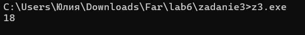
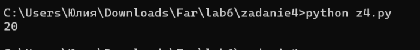
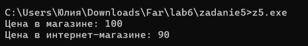
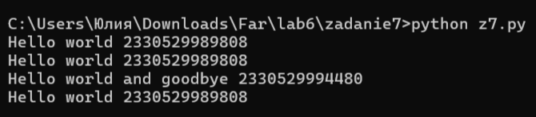
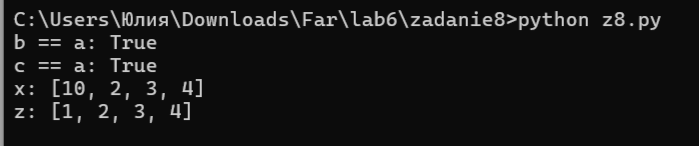
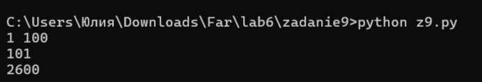

# Языки программирования
## Лабораторная работа 6

### Задание 1 **(3)**
*Рассмотрим следующую программу на С++.*
```
#include <iostream>
#include <cmath>
int main() {
   double x = 0;
   const auto Pi = std::acos(0) * 2;
   std::cout << Pi << std::endl;
   return 0;
}
```
*Проверьте четыре способа объявления* **Pi**.
* ```const auto Pi = acos(0) * 2;```
* ```constexpr auto Pi = std::acos(0) * 2;```
* ```const auto Pi = acos(x) * 2;```
* ```constexpr auto Pi = std::acos(x) * 2;```

*Что можно сказать об этих вариантах? Проверьте, в каких вариантах объявляется константа этапа трасляции.

*Тексты программ разместите в папке с номером задания*


```const auto Pi = std::acos(0) * 2;```
Это константный объект. Ключевое слово const запрещает менять значение после инициализации, но не требует вычисления на этапе трансляции. std::acos — обычная функция, поэтому Pi инициализируется во время выполнения. Программа компилируется и выводит 3.14159.

```constexpr auto Pi = std::acos(0) * 2;```
Формально constexpr требует, чтобы инициализатор был константным выражением, а std::acos в стандартах C++11–C++23 не является constexpr-функцией. Поэтому по строгому стандарту это объявление должно приводить к ошибке компиляции. Однако в используемой мной среде (GCC 14.2.0) компилятор распознаёт std::acos как встроенную (built-in) функцию и вычисляет её на этапе трансляции, поэтому программа успешно компилируется. Это нестандартное расширение компилятора.

```const auto Pi = std::acos(x) * 2; (где x — переменная)```
Аргумент x — переменная, её значение известно только в рантайме, поэтому Pi — константа времени выполнения (константный объект с инициализацией во время выполнения). Программа компилируется и выводит 3.14159.

```constexpr auto Pi = std::acos(x) * 2; (где x — переменная)```
Это гарантированная ошибка компиляции: x не является константным выражением, а std::acos не constexpr. Компилятор выдаёт ошибку the value of 'x' is not usable in a constant expression. Программа не компилируется.


### Задание 2 **(2)**
*Проверьте работу следующей программы на С++*

```
#include <iostream>
int main() {
   {
      int x, y;
      std::cin >> x >> y;
      std::cout << x+y << std::endl;
   }
   {
      double x, y;
      std::cin >> x >> y;
      std::cout << x+y << std::endl;
   }
   return 0;
}
```

В С++ есть правило: внутри одного блока кода нельзя дважды объявлять переменную с одним и тем же именем. Если убрать эти скобки, то оба объявления (int x, y и double x, y) окажутся в теле функции main, то есть в одном и том же месте. Программа станет некорректной, и компилятор её не пропустит.

А скобки { } как раз и создают отдельные области видимости. Сначала мы заходим в первый блок, объявляем там целые x и y, работаем с ними. Как только доходим до закрывающей скобки }, эти переменные уничтожаются — они больше не существуют. После этого мы заходим во второй блок: там имена x и y снова абсолютно свободны, поэтому мы спокойно объявляем их заново, но уже как double. В памяти эти переменные никак не пересекаются и не мешают друг другу.

### Задание 3 **(2)**
*Проверьте работу следующего фрагмента программы на С++.*
```
int s = 0;
for (int i = 0; i < 4; i++) {
   for (int i = 0; i < 3; i++) {
      s += i;
   } 
   s += i; 
}
std::cout << s;
```
*В результате каких вычислений был получен ответ? Дайте подробный ответ.*

В этом коде и во внешнем, и во внутреннем цикле используется переменная с одинаковым именем i. В языке C++ так можно: внутренний цикл создаёт свою собственную переменную i, которая перекрывает внешнюю в пределах своего блока. Пока работает внутренний цикл, он использует свою i, а внешняя i в это время не меняется.

Внутренний цикл каждый раз пробегает значения от 0 до 2, поэтому за один проход внешнего цикла к переменной s прибавляется сумма 0 + 1 + 2 = 3. После того как внутренний цикл закончился, его переменная i уничтожается. Тогда вступает в дело строка s += i; — она берёт уже внешнюю i, которая сохранила своё текущее значение.

Внешняя i = 0. Внутренний цикл добавляет 3 (получается s = 3). Затем s += 0. Итог: 3.

Внешняя i = 1. Внутренний цикл снова добавляет 3 (s = 6). Затем s += 1. Итог: 7.

Внешняя i = 2. Внутренний цикл добавляет 3 (s = 10). Затем s += 2. Итог: 12.

Внешняя i = 3. Внутренний цикл добавляет 3 (s = 15). Затем s += 3. Итог: 18.



### Задание 4 **(2)**

*Проверьте работу следующего фрагмента программы на* **Python**.
```
s = 0
for i in range(4):
   for i in range(3):
      s += i
   s += i
print(s)
```
*В результате каких вычислений был получен ответ? Дайте подробный ответ.*

*На основе этих примеров поясните различия между* **С++** и **Python** *при работе с переменными*.


В Python переменные не привязаны к блокам кода, поэтому имя i здесь одно на всю программу. Внутренний цикл не создаёт новую переменную, а просто перезаписывает ту же самую i.

Когда внутренний цикл for i in range(3) заканчивается, переменная i не исчезает. Она остаётся равной своему последнему значению — числу 2. Из-за этого строка s += i, стоящая после внутреннего цикла, во время каждой итерации внешнего цикла прибавляет именно 2, а не текущее значение внешнего счётчика.

Внутренний цикл прибавляет 0 + 1 + 2 = 3 (s = 3). Затем s += 2. Итог: 5.

Внутренний цикл снова прибавляет 3 (s = 8). Затем s += 2. Итог: 10.

Внутренний цикл прибавляет 3 (s = 13). Затем s += 2. Итог: 15.

Внутренний цикл прибавляет 3 (s = 18). Затем s += 2. Итог: 20.



Различия между C++ и Python при работе с переменными:

В C++ переменная, объявленная внутри блока (например, в заголовке внутреннего цикла), существует только до конца этого блока. После выхода из него снова используется внешняя переменная. В Python переменные не привязаны к блокам кода — они относятся к функции или к глобальной области. Поэтому внутренний цикл изменяет ту же самую переменную i, которая используется во внешнем цикле, и её последнее значение влияет на дальнейшие вычисления.


### Задание 5 **(2)**

*Напишите свой пример программы на* **С++**, *создающий и использующий пространства имен. Программа
должна содержать не менее двух пространств имен.*

```
#include <iostream>

// Первое пространство имен
namespace Shop {
    int price = 100;
    void showPrice() {
        std::cout << "Цена в магазине: " << price << std::endl;
    }
}

// Второе пространство имен
namespace OnlineStore {
    int price = 90;
    void showPrice() {
        std::cout << "Цена в интернет-магазине: " << price << std::endl;
    }
}

int main() {
    // Вызываем функции из разных пространств имен
    Shop::showPrice();
    OnlineStore::showPrice();

    return 0;
}

```
В этой программе я создала два пространства имен: Shop (обычный магазин) и OnlineStore (интернет-магазин). В каждом из них есть переменная с одинаковым названием price (цена) и функция showPrice, которая выводит эту цену на экран.

Этот пример показывает, для чего вообще нужны пространства имен. Если бы я объявила две переменные price просто так, без пространств имен, компилятор выдал бы ошибку, потому что в одной области видимости нельзя дважды использовать одно и то же имя.

Пространства имен решают эту проблему. В функции main я использую оператор разрешения области видимости :: (пишу Shop::showPrice() и OnlineStore::showPrice()). Благодаря этому компилятор четко понимает, к какой именно функции и переменной я обращаюсь. Никакого конфликта имен не происходит, и программа выводит две разные цены.



### Задание 6 **(2)**

*Рассмотрим следующий фрагмент программы. Эта программа 1000000 раз обменивает значения двух длинных 
строк с использованием третьей строки. Проверьте, насколько быстро она работает.*

```
std::string a(100000, 'a');
std::string b(100000, 'b');
for (int i=0;i<1000000;i++) {
   std::string c(a);
   a = b;
   b = c;
}
std::cout << a[0] << b[0];
```
*Попробуйте использовать для обмена значений строк функцию* **swap**. 
*Проверьте, изменилось ли время работы. В чем ошибка исходной программы?
Исправьте исходную программу, чтобы ускорить ее работу. Изменения не должны 
затрагивать общий вид программы (присваивания, использование временной переменной).*

Я запустила исходную программу, и она выполняется очень долго. Если заменить внутренности цикла на std::swap(a, b);, то программа выполнится практически мгновенно, так как эта функция не копирует символы, а просто меняет местами внутренние указатели строк.

Ошибка исходного кода заключается в глубоком копировании. Строки std::string хранят свои символы в динамической памяти. Когда я пишу std::string c(a);, создаётся абсолютно новая строка, и в неё посимвольно копируются все 100 000 символов. Затем a = b; снова копирует 100 000 символов, и b = c; делает то же самое. Миллион повторений такого копирования создаёт огромную и совершенно ненужную нагрузку на память и процессор.

Чтобы ускорить программу, я заменила копирование на перемещение с помощью std::move.

```
#include <iostream>
#include <string>
#include <utility>

int main() {
    std::string a(100000, 'a');
    std::string b(100000, 'b');
    for (int i = 0; i < 1000000; i++) {
        std::string c(std::move(a));
        a = std::move(b);
        b = std::move(c);
    }
    std::cout << a[0] << b[0];
    return 0;
}
```

В этом варианте я использую std::move. Эта функция указывает компилятору, что старое значение переменной больше не понадобится и его можно перенести в новую переменную. Поэтому компьютеру не приходится заново переписывать все 100 000 символов — строка просто передает свой внутренний буфер другой переменной, а сама становится пустой. Присваивания и временная переменная c остались на месте, но теперь программа работает так же быстро, как и с swap.


### Задание 7 **(2)**

*Рассмотрим программу на языке* **Python**.

```
a = 'Hello world'
print(a, id(a))
b = a
print(b, id(b))
a += ' and goodbye'
print(a, id(a))
print(b, id(b))
```
*Объясните ее работу. В какой момент создавались строки? 
Что означает значение, возвращенное функцией* **id**?

Функция id() возвращает уникальный целочисленный идентификатор объекта (по сути, его адрес в оперативной памяти). Если у двух переменных одинаковый id, значит, они ссылаются на один и тот же объект в памяти.

a = 'Hello world': Создается первый строковый объект в памяти. Переменная a начинает ссылаться на него.

b = a: В Python операция присваивания не копирует саму строку. Переменная b просто начинает ссылаться на тот же самый объект, что и a. Поэтому id(a) и id(b) на этом этапе будут одинаковыми.

a += ' and goodbye': Здесь происходит самое важное. Строки в Python являются неизменяемыми (immutable). Это значит, что изменить существующую строку (дописать в конец символы) невозможно. Python создает новую строку в памяти, объединяя старую с новой частью, и переменная a начинает ссылаться на этот новый объект. Из-за этого id(a) изменится.

print(b, id(b)): Переменная b так и осталась ссылаться на самую первую строку 'Hello world'. Она не знает о том, что переменная a была переприсвоена. Ее id останется прежним.




### Задание 8 **(2)**

*Пусть* **a** - *строковая переменная в программе на* **Python**.
*Есть ли разница между работой присваивания*
```b = a```
и
```b = a[:]```
*Напишите программу для демонстрации различий.*
При записи b = a переменная b просто начинает ссылаться на тот же самый объект в памяти, что и a. Никакой новой строки не создаётся, это просто копирование ссылки.

При записи b = a[:] используется операция среза. В Python срез всегда создает копию, то есть в памяти появляется новый объект (новая строка), куда копируется содержимое исходной.

Так как строки в Python неизменяемы, изменить их на месте всё равно нельзя. Поэтому внешне поведение может показаться одинаковым. Но с точки зрения памяти это разные вещи: во втором случае создается новый объект.

```
a = "Hello"
b = a
c = a[:]

print("b == a:", b == a)  # True
print("c == a:", c == a)  # True

x = [1, 2, 3, 4]
y = x       # Это ссылка на тот же объект
z = x[:]    # Это копия (новый объект)
y[0] = 10   # Меняем первый элемент через y

print("x:", x)  # [10, 2, 3, 4] — x изменился, так как y это ссылка на него
print("z:", z)  # [1, 2, 3, 4]  — z остался прежним, так как это независимая копия
```


###  Задание 9 **(3)**
*Напишите программу на языке* **Python**, *которая создаст 2600 переменных с именами
от* **a0** *до* **a99**, *от* **b0** *до* **b99** *и так далее, от* **z0** *до* **z99**. 
*Присвойте всем переменным различные значения от 1 до 2600.*

```
value = 1
for letter in 'abcdefghijklmnopqrstuvwxyz':
    for num in range(100):
        globals()[f'{letter}{num}'] = value
        value += 1

print(a0, a99) 
print(b0)        
print(z99)       
```
В Python переменные хранятся в виде словаря. Функция globals() дает доступ к словарю глобальных переменных.

Я использую два цикла: внешний перебирает буквы от a до z, а внутренний — числа от 0 до 99. В строке globals()[f'{letter}{num}'] = value я склеиваю букву с числом (например, "a0") и создаю переменную с этим именем, присваивая ей текущее значение счетчика. После этого счетчик value увеличивается на 1.

В конце программа выводит значения нескольких переменных для проверки, подтверждая, что все 2600 переменных созданы и числа идут по порядку от 1 до 2600.



## Дополнительные задания

### Задание 1 **(3)**

*Пусть* **a**, **b**  *два списка в* **Python**. *Мы хотим обменять значения переменных следующим
образом.*
```
a, b = b, a
```
*Будет ли это работать? В какой последовательности будут происходить присваивания?
Будет ли зависеть время работы от размера списков? Обоснуйте ответ.*

### Задание 2 **(3)**
*Проверьте результаты сравнения в* **Python**.
```
id(100)==id(100)
```
и
```
id(1000)==id(1000)
```
*Как можно объяснить полученные результаты?*

### Задание 3 **(4)**
*Напишите функцию* **sumint** на **Python**, *которая найдет сумму всех целочисленных переменных, определенных
в среде* **Idle**. *Например*
```
>>> a = 10
>>> b = 1.5
>>> c = 15
>>> d = 'hello'
>>> sumint()
25
```

### Задание 4 **(10)**

*В языке* **С++** *для получения информации о расположении переменной в памяти 
можно использовать оператор взятия адреса* **&**. *Адрес можно интерпретировать, как 
беззнаковое длинное число с использованием* **reinterpret_cast**.

```
reiterpret_cast<unsigned long long>(&t);
```
*Здесь* **t** *имя некоторой переменной. Напишите несколько примеров, чтобы проверить, 
как размещаются переменные в памяти. В частности, можно рассмотреть следующие вопросы.*
* *Если объявить несколько переменных различных типов в одном блоке, то на какую величину 
отличаются их адреса? Соотносится ли эта величина с размером переменной в байтах.
Проверьте, имеются ли различия на разных уровнях оптимизации.*
* *Если имеется несколько блоков, расположенных последовательно, то могут ли переменные
в разных блоках иметь одинаковые адреса? Проверьте разные уровни оптимизации.*
* *Объявите несколько переменных типа* **std::string** *и попробуйте заносить
в них строки различной длины. Изменяется ли размер переменной, вычисленный с использованием*
**sizeof**? *Изменяется ли расположение переменной? Попробуйте объяснить полученные результаты.*


