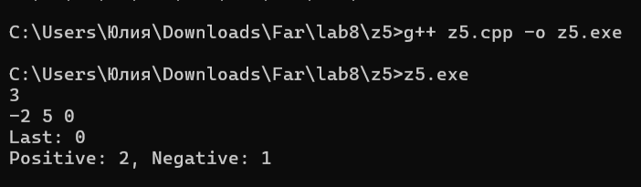
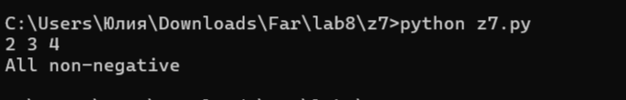
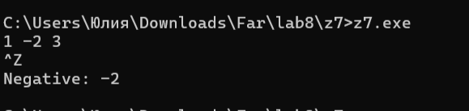
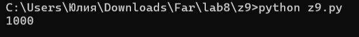

# Языки программирования
## Лабораторная работа 8

### Задание 1 **(2)**
*Рассмотрим программу на языке* **Python**.
```
x = [int(t) for t in input().split()]
for i in range(len(x)):
   if x[i] < i or x[i] > 2*i:
      break
print(i)
```
*Перепишите эту программу так, чтобы в ней использовался цикл* **while**, *в ней не использовалась
инструкция* **break**, *а используемый алгоритм не изменился. Полученная программа должна иметь следующий 
вид.*
```
x = [int(t) for t in input().split()]
i = 0
while ...:
   i += 1
print(i)
```
Цикл for перебирает индексы. Если встречается число 1 или число больше 2, цикл прерывается (break). После выхода печатается индекс i, на котором это произошло. Если таких чисел нет, i будет равен len(x) - 1.
*Допишите правильное логическое выражение вместо многоточия. Выражение не должно содержать оператор* **not**.

Решение
```
x = [int(t) for t in input().split()]
i = 0
while i < len(x) and x[i] != 1 and x[i] <= 2:
    i += 1
print(i)
```
Логическое выражение: i < len(x) and x[i] != 1 and x[i] <= 2

Мы продолжаем цикл, пока не дошли до конца (i < len(x)), и пока текущий элемент не равен 1 (x[i] != 1), и пока он не больше 2 (x[i] <= 2). Как только одно из условий нарушится (встретили 1 или >2), цикл остановится, и i останется на нужном индексе.


### Задание 2 **(2)**
*Рассмотрим программу на языке* **Python**.
```
x = [int(t) for t in input().split()]
for i in range(len(x)):
   if i <= x[i] < 2*i or 3*i <= x[i] < 4*i:
      break
print(i)
```
*Перепишите эту программу так, чтобы в ней использовался цикл* **while**, *в ней не использовалась
инструкция* **break**, *а используемый алгоритм не изменился. Полученная программа должна иметь следующий 
вид.*
```
x = [int(t) for t in input().split()]
i = 0
while ...:
   i += 1
print(i)
```
*Допишите правильное логическое выражение вместо многоточия. Выражение не должно содержать оператор* **not**.

```
x = [int(t) for t in input().split()]
i = 0
while i < len(x) and not (i <= x[i] < 2*i or 3*i <= x[i] < 4*i):
    i += 1
print(i)
```
Логическое выражение: i < len(x) and not (i <= x[i] < 2*i or 3*i <= x[i] < 4*i)

Мы должны продолжать цикл, пока условие из if ложно. Поэтому мы берем условие из if в скобки и ставим перед ним not.


### Задание 3 **(2)**

*Напишите пример программы на* **Java** *с двумя вложенными циклами и инструкцией* **break** *для выхода
из двух вложенных циклов. В качестве такой программы можно взять поиск первого нуля в двумерном массиве.*

```
public class Main {
    public static void main(String[] args) {
        int[][] matrix = {{1, 2}, {0, 3}};
        boolean found = false;
        
        for (int i = 0; i < matrix.length; i++) {
            for (int j = 0; j < matrix[i].length; j++) {
                if (matrix[i][j] == 0) {
                    System.out.println("Ноль найден на позиции: " + i + "," + j);
                    found = true;
                    break; 
                }
            }
            if (found) break;
        }
    }
}
```


### Задание 4 **(2)**

*Рассмотрим программу на языке* **Python**.
```
a = list(range(10))
b = [a.pop() - x for x in a]
print(*b)
```
*Объясните, почему список* **b** *получился именно таким.*

Программа выводит список квадратов чисел от 0 до 9: [0, 1, 4, 9, 16, 25, 36, 49, 64, 81].

range(10) создает последовательность 0...9. Конструкция [x*x for x in a] — это генератор списка. Он берет каждый элемент x из списка a, возводит его в квадрат (x*x) и добавляет результат в новый список b.


### Задание 5 **(2)**

*Напишите программу на С++, которая прочитает натуральное число* **n**, *создаст вектор
из* **n** *элементов, прочитает значения элементов, добавит последний элемент вектора к каждому элементу 
(в том числе и к последнему), найдет и выведет количество положительных и отрицательных элементов вектора
после изменения. Из циклов в программе можно использовать только циклы по коллекции.*

```
#include <iostream>
#include <vector>

int main() {
    int n;
    std::cin >> n;
    std::vector<int> vec(n);
   
    for (int i = 0; i < n; ++i) {
        std::cin >> vec[i];
    }
    
    std::cout << "Last: " << vec[n-1] << "\n";
    
    int idx = 0;
    for (int& x : vec) {
        x += idx;
        idx++;
    }
    
    int pos = 0, neg = 0;
    for (int x : vec) {
        if (x > 0) pos++;
        else if (x < 0) neg++;
    }
    
    std::cout << "Positive: " << pos << ", Negative: " << neg << "\n";
    return 0;
}
```



### Задание 6 **(3)**

*Представим, что в некотором будущем стандарте* **С++** *появится конструкция*
```
forc(i, from, to)
```
*которая будет раскрываться в следующий код.*
```
{
   int __i = from, __n=to;
   for(const int &i= __i; i < __n; __i++) {
      ...
   }
}
```
*Чем эта конструкция отличается от стандартного цикла* **for**? *Укажите два основных различия.
Напишите программы для демонстрации этих различий.*

*Написанные программы сохраните в папку с номером задания.*


1. Переменная цикла доступна только для чтения.

В обычном цикле for (int i = 0; ...) мы можем внутри тела цикла написать i = 10; или i += 5;. Программа скомпилируется, но логика цикла сломается. В новой конструкции i объявлена как const int &i (константная ссылка). Любая попытка изменить i внутри цикла вызовет ошибку компиляции. Это защищает программиста от случайного изменения счётчика.

2. Границы цикла фиксируются.

В новой конструкции верхняя граница to запоминается один раз в переменной _n перед началом цикла. В обычном for условие i < to проверяется на каждой итерации. Если внутри цикла изменить переменную to, обычный цикл это «увидит», а новая конструкция — нет.

1:

```
#include <iostream>

int main() {
    int arr[] = {10, 20, 30};
    
    for (const int& i : arr) {
        std::cout << i << " ";
        // i = 5;
    }
    std::cout << "\n";
    return 0;
}
```

Если убрать комментарий со строки i = 5;, компилятор выдаст ошибку. Это доказывает, что переменная i защищена от изменений.

.png)

error.png)

2:

```
#include <iostream>

int main() {
    for (int i = 0; i < 3; i++) {
        std::cout << i << " ";
    }
    std::cout << "\n";
    
    // std::cout << i;
    return 0;
}
```

Если убрать комментарий с cout << i;, компилятор скажет, что i не существует. Это объясняет, зачем в новой конструкции нужен блок { ... } — чтобы переменная была доступна только внутри цикла.

.png)

error.png)

### Задание 7 **(2)**

*Напишите программу на языке* **Python** *для проверки того, что все числа во введенной 
последовательности неотрицательные. Если в цикле будет найдено отрицательное число, цикл должен
прерваться и вывести найденное число. Если отрицательных чисел нет, то вывести некоторое сообщение об этом.*

*Программа должна использовать конструкцию* **for break else**.

*Запишите аналогичную программу на С++. Какие изменения в алгоритме решения в ней появились?. Почему?*

*Написанные программы сохраните в папку с номером задания.*

Python

```
nums = list(map(int, input().split()))
for x in nums:
    if x < 0:
        print("Negative:", x)
        break
else:
    print("All non-negative")
```
Блок else в цикле for выполняется только в том случае, если цикл завершился естественным образом (без break).



C++

```
#include <iostream>
#include <vector>

int main() {
    std::vector<int> nums;
    int x;
    while (std::cin >> x) nums.push_back(x);
    
    bool has_negative = false;
    for (int n : nums) {
        if (n < 0) {
            std::cout << "Negative: " << n << "\n";
            has_negative = true;
            break;
        }
    }
    if (!has_negative) {
        std::cout << "All non-negative\n";
    }
    return 0;
}
```
В C++ нет конструкции for...else. Поэтому нам приходится использовать логический флаг (has_negative). Если нашли отрицательное число, ставим флаг true и выходим из цикла (break). После цикла проверяем флаг: если он false, значит, отрицательных не было.



### Задание 8 **(2)**

*Рассмотрим следующую программу.* 
```
if x>=5 and y>=-5:
   print(0)
elif x<0 or y<0:
   print(1)
else:
   print(2)
```

*Нарисуйте на координатной плоскости множества значений при которых программа выводит 0, 1 и 2.*
*Фотографию рисунка вставьте в отчет*
*Опишите эти множества значений, используя язык теории множеств. Например,* A = { (x,y)| x ∈ [5;∞), y ∈ [-5;∞)}.


###  Задание 9 **(3)**
*Напишите программу на языке Python для решения следующей задачи.*

*Задана пронумерованная последовательность логических значений* **t(0), t(1), ..., t(n)**, **t(i) ∈ {False, True}**

*Последовательность обладает следующим свойством: существует некоторое число k такое, что 
все значения* **t(0), t(1), ..., t(k-1)** *равны* **False**, *а все значения* **t(k), ..., t(n)** *равны* **True**,
*то есть слева от* **k** *находятся значения* **False**, *а справа* - **True**. *Последовательность задается
функцией* **t(i)**, *которая возвращает логическое значение. Например, для тестирования эту функцию можно
задать следующим образом.*
```
def t(i):
   return i >= 1000
```

*Требуется написать программу, которая найдет число* **k**. *Программа должна реализовывать алгоритм 
бинарного поиска. Диапазон поиска задается переменными* **left** и **right**. *На каждом шаге вычисляется
центр диапазона, значение в нем проверяется, после чего диапазон сокращается в два раза.*

*Алгоритм должен быть записан через цикл* **while** *и реализовывать инвариант цикла*

t(left)=False ∧ t(right)=True

```
left = -1
right = 10**18
while ...:
   mid = ...
   if t(mid):
      ...
   else:
      ...
print(...)
```

Моё решение 

```
def t(i):
    return i >= 1000

left = -1
right = 10**18
while right - left > 1:
    mid = (left + right) // 2
    if t(mid):
        right = mid
    else:
        left = mid
print(right)
```



## Дополнительные задания

### Задание 1 **(5)**

*Напишите программу на языке С++, которая будет находить сумму элементов в матрице и использовать для суммирования только один цикл* **for**. *(То есть вложенные циклы использовать нельзя).*

### Задание 2 **(15)**
*Напишите программы на языке С++ с использованием разных видов циклов, ветвлений в полной и краткой форме, переведите их в ассемблерный код без оптимизации и опишите, как реализуются эти конструкции в элементарных командах.
правил.*

